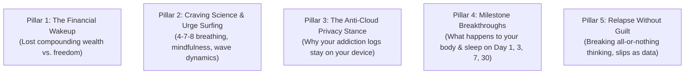

# PuffinLess — Commercial Marketing, Social Media & Content Strategy

**Classification:** Commercial Growth Playbook & Go-To-Market Execution Plan  
**Target Product:** PuffinLess v2.4 (Commercial Habit Tracker & Sobriety Companion)  
**Author:** PuffinLess Commercial Architecture Team  
**Date:** November 2026  

---

## 1. Brand Positioning & Core Value Proposition

PuffinLess stands at the intersection of two powerful modern consumer shifts:
1. **The Habit & Sobriety Wave**: People wanting to quit or reduce cigarettes, disposable nicotine vapes (puffs), and cannabis.
2. **The Local-First Privacy Awakening**: Growing frustration with intrusive subscription apps that demand logins, harvest personal mental health/addiction data, and sell information to third-party ad networks.

### Core Value Tagline
> **"Break free from Cigarettes, Vapes & Weed. Keep 100% of your records on your device."**

### Why PuffinLess Converts
| Friction in Other Apps | PuffinLess Solution |
| :--- | :--- |
| **Expensive Subscriptions** ($49–$99/yr) | **One-time payment** ($19.99 lifetime). Pays for itself in 48 hours of sobriety. |
| **Data Harvesting & Cloud Leaks** | **100% Local-First**. Records live directly on your private device. Zero cloud database. |
| **Cigarettes Only** | **Tri-Substance Precision**. Tracks cigarettes, nicotine vapes, and cannabis simultaneously. |
| **Guilt & Shame Spirals on Relapse** | **Mindful Coaching**. Slips are recorded as data, not defeat. |
| **Forced Account Signups** | **Zero accounts required**. Open and start immediately. |

---

## 2. Social Media Setup & Platform Strategy

To attract clients consistently without paid ads, focus on the 4 highest-converting organic channels:

### 1. TikTok (@puffinless.app) — *Top Discovery Engine*
* **Primary Objective**: Top-of-funnel virality using relatable short-form video.
* **Target Audience**: Gen Z & Millennials struggling with vape/puff addiction or daily weed use.
* **Bio Template**:
  ```text
  Conquer Cigarettes, Vapes & Weed 🚭
  Zero cloud • 100% private on your phone 📱
  No subscriptions. Pay once, own forever.
  👇 Start your smoke-free streak today
  [puffinless.com]
  ```

### 2. Instagram (@puffinless) — *Visual Authority & Social Proof*
* **Primary Objective**: Aesthetic carousels, financial comparison infographics, daily streak celebrations.
* **Format**: Reels (repurposed from TikTok), 5-slide educational carousels, Stories with interactive polls.
* **Bio Template**:
  ```text
  PuffinLess 🛡️ The Private Habit Tracker
  Track cigarettes, vapes & weed without monthly fees.
  ⚡ Guided SOS Crave Interceptor
  💰 See your 10-year compound wealth
  🔗 Get instant lifetime access 👇
  [puffinless.com]
  ```

### 3. X (Twitter) & Threads (@puffinless) — *Tech, Privacy & Philosophy*
* **Primary Objective**: Building in public, anti-cloud privacy advocacy, and habit psychology insights.
* **Format**: Punchy 1-2 sentence habit observations, financial reality checks, screenshots of local-first code.
* **Bio Template**:
  ```text
  The offline-first habit companion. Quitting cigarettes, vapes, and weed without cloud tracking or subscription traps. Built local-first.
  ```

### 4. LinkedIn — *Workplace Wellness & Executive Clarity*
* **Primary Objective**: B2B professionals, founders, and knowledge workers seeking high focus and stamina.
* **Format**: Thought leadership on dopamine depletion from vaping, financial lost-opportunity analysis, and productivity gains.

---

## 3. The 5 Core Content Pillars

Every post must belong to one of these 5 pillars to maintain a balanced, high-converting feed:



1. **Pillar 1: The Financial Wakeup (30% of content)**
   * Showcases the brutal math of nicotine/weed expenditure compounded over 10 years at 7% market return.
   * *Emotion triggered:* Shock & empowerment.

2. **Pillar 2: Craving Science & Urge Surfing (25% of content)**
   * Actionable micro-tools: 4-7-8 breathing, 5-4-3-2-1 sensory grounding, why an urge crests and subsides.
   * *Emotion triggered:* Relief & self-efficacy.

3. **Pillar 3: The Anti-Cloud Privacy Movement (20% of content)**
   * Questions why health apps demand accounts and sell habit profiles to advertisers.
   * *Emotion triggered:* Trust, respect, and technical alignment.

4. **Pillar 4: Milestone Breakthroughs & Sleep Quality (15% of content)**
   * Tracking deep sleep rebounds, morning energy, and taste/smell recovery.
   * *Emotion triggered:* Excitement and forward momentum.

5. **Pillar 5: Relapse Without Guilt (10% of content)**
   * Reframing a slip from "catastrophe" to "data collection".
   * *Emotion triggered:* Safety and compassion.

---

## 4. 30-Day Daily Content Posting Calendar

| Day | Pillar | Platform | Content Angle / Hook | Format |
| :---: | :---: | :---: | :--- | :---: |
| **Day 1** | Finance | TikTok / Reels | *"How much smoking 1 pack a day actually costs you in 10 years (Hint: It’s a Tesla)."* | Short Video (Calculator screen) |
| **Day 2** | Science | Instagram | *Why cravings feel endless—and why taking a 3-minute pause breaks the automatic reflex.* | 5-Slide Carousel |
| **Day 3** | Privacy | X / Threads | *"Your addiction logs shouldn't be sold to insurance algorithms. Why we built PuffinLess local-first."* | Text Thread |
| **Day 4** | Milestones | TikTok / Reels | *Day 1 vs. Day 3 vs. Day 7 of no vaping: what actually changes in your chest and sleep.* | Talking Head / Voiceover |
| **Day 5** | Finance | Instagram | *The "Coffee & Cigarette" tax: how a daily morning habit drains €450/month without noticing.* | Single Stat Graphic |
| **Day 6** | Urge Surf | TikTok / Reels | *Guided 4-7-8 breath with the PuffinLess SOS button (Try this right now if you have a craving).* | Interactive Screen Record |
| **Day 7** | Relapse | X / LinkedIn | *The "What the Hell" effect: why smoking one cigarette makes you smoke twenty—and how to stop the spiral.* | Long-form Post |
| **Day 8** | Science | TikTok / Reels | *Why disposable vapes are 10x harder to quit than cigarettes (Continuous micro-puffing loop).* | Educational Breakdown |
| **Day 9** | Finance | Instagram | *Visualizing €4,900 saved in 1 year: 3 luxury vacations or 1 investment portfolio.* | Carousel Comparison |
| **Day 10** | Privacy | TikTok / Reels | *POV: An app that doesn't ask for your email, doesn't sell ads, and doesn't charge €10/month.* | App Demo Showcase |
| **Day 11** | Milestones | Instagram | *The REM sleep rebound: why stopping weed gives you wild, ultra-vivid dreams in week 2.* | Infographic |
| **Day 12** | Science | X / Threads | *The 5-4-3-2-1 reset: how engaging your 5 senses pulls your brain out of automatic smoking autopilot.* | Tactical Guide |
| **Day 13** | Finance | TikTok / Reels | *Showing people our compound wealth calculator on the street / live screen test.* | Screen Reaction Video |
| **Day 14** | Urge Surf | Instagram | *What to do with your restless hands when you quit vaping (5 practical physical swaps).* | Carousel Guide |
| **Day 15** | Product | TikTok / Reels | *Why we made PuffinLess a one-time purchase instead of an endless €60/year subscription trap.* | Founder Story |
| **Day 16** | Science | X / Threads | *The myth of "I smoke to relieve stress": how nicotine creates the exact anxiety it temporarily relieves.* | Bulleted Insight |
| **Day 17** | Milestones | TikTok / Reels | *Week 1 smoke-free check-in: the hardest 72 hours are officially behind you.* | Motivational Short |
| **Day 18** | Finance | Instagram | *Where does your vape money actually go? Breaking down the true annual cost of pods & disposables.* | Breakdown Graphic |
| **Day 19** | Relapse | TikTok / Reels | *Did you have a slip today? Don't reset your journey to zero. Here's what to do instead.* | Empathetic Coach Video |
| **Day 20** | Privacy | LinkedIn | *Data sovereignty in personal health: why on-device local storage is the future of sensitive consumer apps.* | Professional Article |
| **Day 21** | Science | TikTok / Reels | *The dopamine dip on Day 4: why you feel irritable and how to navigate it with cold water and walks.* | Educational Short |
| **Day 22** | Urge Surf | Instagram | *3 breathing techniques tested: Box breathing vs. 4-7-8 vs. Physiological sigh.* | Comparison Carousel |
| **Day 23** | Finance | X / Threads | *Over 10 years, a €15/day habit costs €68,000+ when invested at standard market returns.* | Single Tweet |
| **Day 24** | Milestones | TikTok / Reels | *Day 14: Tastebuds wake up. Food starts tasting like it actually has flavor again.* | Relatable Humor Video |
| **Day 25** | Product | Instagram | *Inside our dark mode design: high-contrast white metrics engineered to be read anywhere.* | UI Showcase Carousel |
| **Day 26** | Science | TikTok / Reels | *Why your brain screams "just one puff" when you're having a drink with friends.* | Nightlife Strategy |
| **Day 27** | Relapse | X / Threads | *A streak is not a fragile glass sculpture. It's a muscle you are training every day.* | Motivational Thread |
| **Day 28** | Finance | TikTok / Reels | *Rewarding your milestones: how to buy something meaningful with your first €200 saved.* | Lifestyle Video |
| **Day 29** | Milestones | Instagram | *30 Days Clean: Lung capacity improvements, resting heart rate drop, and self-trust restored.* | Celebration Graphic |
| **Day 30** | Product | All Channels | *Monthly roundup: over €150,000 preserved in user pockets across our local-first community.* | Milestone Announcement |

---

## 5. Viral Short-Form Video Script Templates

### Template A: The Compound Wealth Shock (TikTok / Reels)
* **Visual**: Starting with a close-up of a pack of cigarettes or vape pod on a table, transitioning to the PuffinLess savings slider moving in real time.
* **Hook (0-3s)**: *"If you smoke or vape daily, you aren’t just spending €12 a day. You are actively burning a €68,000 down payment."*
* **Body (3-20s)**:
  * *"Let's do the real math on PuffinLess. 15 cigarettes a day at €12.50 a pack equals €310 a month. Add a couple of vape pods, and you're over €400."*
  * *"Over one year, that's nearly €5,000 pure cash. But if you invested that same money in a basic index fund at 7% return, in 10 years you’re holding over €68,000."*
* **Call to Action (20-30s)**:
  * *"Stop paying big tobacco to destroy your lungs. Download PuffinLess—it’s a one-time purchase with zero subscriptions, and your data stays 100% on your device. Link in bio."*

---

### Template B: The 3-Minute Craving Wave (TikTok / Reels)
* **Visual**: Screen capture of the PuffinLess SOS Crave Interceptor pulsing with the 4-7-8 breathing circle.
* **Hook (0-3s)**: *"Stop fighting cravings with willpower. Your willpower will always lose to biology."*
* **Body (3-20s)**:
  * *"Here is what nobody tells you about nicotine and weed cravings: they peak like an ocean wave within 2 to 3 minutes, and then they subside."*
  * *"If you panic, your heart rate spikes and the craving feels eternal. But if you open the PuffinLess SOS button and follow 3 cycles of 4-7-8 breathing, you force your body into a calm state until the wave passes."*
* **Call to Action (20-30s)**:
  * *"Ride out the wave instead of giving in. Tap the link in bio to get PuffinLess on your phone."*

---

### Template C: The Anti-Subscription / Privacy Manifesto (TikTok / Reels)
* **Visual**: Founder talking directly to camera, showing PuffinLess running on an iPhone with airplane mode turned on.
* **Hook (0-3s)**: *"Why does every quit-smoking app charge $70 a year and ask for your email address?"*
* **Body (3-20s)**:
  * *"Your addiction logs, cravings, and personal notes are none of our business. That’s why we built PuffinLess differently."*
  * *"Zero accounts. Zero cloud databases. No monthly subscriptions. All your records stay directly in your phone's memory. You buy it once, and it’s yours forever—even in airplane mode."*
* **Call to Action (20-30s)**:
  * *"Keep your health journey private. Get PuffinLess today at puffinless.com."*

---

## 6. Conversion Funnel: Turning Viewers into Buyers

```
[ Short-Form Video / Carousel ] (TikTok, Instagram, X)
             │
             ▼
     [ Bio Link Click ]
             │
             ▼
[ PuffinLess Landing Page (website/index.html) ]
 - Interactive Savings Slider
 - Feature Showcase & Honest Comparison
 - 1-Click French / English Toggle
 - €19.99 Lifetime Access Guarantee
             │
             ▼
   [ Instant Stripe / Gumroad Checkout ]
             │
             ▼
[ Instant Download: Standalone HTML + PWA Access ]
```

### Key Conversion Triggers on the Landing Page:
1. **Interactive Engagement**: Letting visitors slide their own cigarette/vape consumption directly engages self-interest.
2. **Instant Economic Rationalization**: At €19.99 one-time, PuffinLess costs less than 2 days of smoking. The purchase is completely self-funding.
3. **No Account Friction**: Buyers download the standalone app or install the PWA instantly without filling out account forms or passwords.
