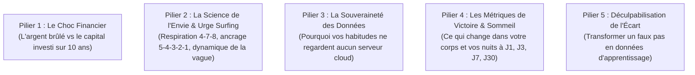

# PuffinLess — Stratégie Commerciale, Réseaux Sociaux & Idées de Contenu

**Classification :** Plan d'Action Marketing & Guide d'Acquisition Client  
**Produit Visé :** PuffinLess v2.4 (Application Autonome de Suivi d'Habitudes & Compagnon de Sobriété)  
**Auteur :** Équipe Commerciale & Architecture PuffinLess  
**Date :** Novembre 2026  

---

## 1. Positionnement de Marque & Proposition de Valeur

PuffinLess s'inscrit au carrefour de deux grandes tendances actuelles :
1. **Le Mouvement d'Arrêt & de Maîtrise des Habitudes** : Le besoin massif d'arrêter ou de réduire le tabac, les puffs/cigarettes électroniques jetables et le cannabis.
2. **Le Réveil de la Souveraineté Numérique (Local-First)** : Le rejet croissant des applications à abonnement qui exigent des inscriptions obligatoires, collectent des données intimes d'addiction et les revendent à des régies publicitaires.

### Slogan Central
> **« Libérez-vous du Tabac, de la Vape et du Cannabis. Vos données restent à 100% sur votre appareil. »**

### Pourquoi PuffinLess Convertit Immédiatement
| Frustrations des Autres Applications | Solution PuffinLess |
| :--- | :--- |
| **Abonnements Récurrents Chers** (49 € à 99 €/an) | **Achat unique** (19,99 € à vie). Rentabilisé en moins de 48 heures d'abstinence. |
| **Collecte & Fuites Cloud** | **100% Local-First**. Enregistrements stockés dans la mémoire locale (IndexedDB). Zéro serveur cloud. |
| **Tabac Classique Uniquement** | **Précision Multi-Substances**. Cigarettes, puffs/vapes et cannabis suivis simultanément. |
| **Culpabilisation en Cas d'Écart** | **Accompagnement Bienveillant**. Un faux pas est une donnée d'apprentissage, pas un échec. |
| **Création de Compte Forcée** | **Zéro compte requis**. Démarrage immédiat sans e-mail ni mot de passe. |

---

## 2. Configuration des Réseaux Sociaux & Stratégie par Plateforme

Pour attirer des clients réguliers de façon organique sans budget publicitaire initial, concentrez-vous sur les 4 canaux les plus efficaces :

### 1. TikTok (@puffinless.app) — *Le Moteur de Visibilité Organique*
* **Objectif Principal** : Viriliser du contenu court et percutant.
* **Audience Cible** : 18-35 ans souhaitant sortir de la dépendance aux puffs et au cannabis récréatif.
* **Modèle de Biographie (Bio)** :
  ```text
  Vaincre la Cigarette, la Vape & le Cannabis 🚭
  Zéro cloud • 100% privé sur ton téléphone 📱
  Zéro abonnement. Un achat unique, à toi pour toujours.
  👇 Calcule tes économies & commence aujourd'hui
  [puffinless.com]
  ```

### 2. Instagram (@puffinless) — *Autorité Visuelle & Preuve Sociale*
* **Objectif Principal** : Carrousels pédagogiques esthétiques, infographies de calcul d'argent perdu, célébration des victoires d'abstinence.
* **Format** : Reels (déclinés de TikTok), carrousels de 5 diapositives, Stories avec sondages interactifs.
* **Modèle de Biographie (Bio)** :
  ```text
  PuffinLess 🛡️ Le Compagnon de Sobriété Privé
  Arrête la clope, la vape & le cannabis sans abonnement mensuel.
  ⚡ Bouton SOS d'urgence & Respiration 4-7-8
  💰 Visualise ton capital cumulé sur 10 ans
  🔗 Accès immédiat à vie 👇
  [puffinless.com]
  ```

### 3. X (Twitter) & Threads (@puffinless) — *Tech, Vie Privée & Philosophie*
* **Objectif Principal** : « Build in public », promotion du mouvement Local-First et décryptage des mécanismes de l'habitude.
* **Format** : Pépites courtes de 1-2 phrases, captures d'écran de l'application, vérités sur les finances personnelles.

### 4. LinkedIn — *Santé en Entreprise & Performance Personnelle*
* **Objectif Principal** : Cadres, freelances et professionnels cherchant à maximiser leur énergie, leur sommeil et leur concentration.
* **Format** : Articles de réflexion sur l'impact de la nicotine sur le sommeil profond et le coût d'opportunité financier.

---

## 3. Les 5 Piliers de Contenu Quotidien

Chaque publication doit s'inscrire dans l'un de ces 5 piliers pour bâtir une audience engagée et acheteuse :



1. **Pilier 1 : Le Choc Financier (30% des posts)**
   * Démontre la réalité mathématique de la dépense tabac/vape projetée sur 10 ans avec intérêts composés (7% par an).
   * *Émotion suscitée :* Prise de conscience et envie d'agir.

2. **Pilier 2 : La Science de l'Envie & Urge Surfing (25% des posts)**
   * Outils concrets applicables en 3 minutes : respiration 4-7-8, ancrage sensoriel, observation bienveillante de l'impulsion.
   * *Émotion suscitée :* Soulagement et confiance en soi.

3. **Pilier 3 : Le Respect Total de la Vie Privée (20% des posts)**
   * Dénonce les applications qui obligent à créer un compte et monétisent l'intimité de leurs utilisateurs.
   * *Émotion suscitée :* Confiance et adhésion aux valeurs de l'app.

4. **Pilier 4 : Les Métriques de Victoire & Sommeil (15% des posts)**
   * Mesure de la récupération du sommeil paradoxal, baisse du rythme cardiaque et énergie retrouvée au réveil.
   * *Émotion suscitée :* Motivation et projection positive.

5. **Pilier 5 : Déculpabilisation de l'Écart (10% des posts)**
   * Pourquoi un écart n'annule pas tous les efforts accomplis et comment repartir immédiatement.
   * *Émotion suscitée :* Bienveillance et fidélisation.

---

## 4. Calendrier Éditorial : 30 Jours de Contenu Quotidien

| Jour | Pilier | Plateforme | Angle & Accroche (Hook) | Format |
| :---: | :---: | :---: | :--- | :---: |
| **Jour 1** | Finance | TikTok / Reels | *« Combien fumer 1 paquet par jour te coûte réellement en 10 ans (Spoiler : le prix d’une Tesla). »* | Vidéo courte (curseur PuffinLess) |
| **Jour 2** | Science | Instagram | *Pourquoi une envie semble insurmontable — et pourquoi marquer une pause de 3 minutes désamorce le réflexe.* | Carrousel 5 slides |
| **Jour 3** | Privée | X / Threads | *« Vos données de santé intimes ne devraient jamais finir dans les algorithmes des régies de pub. Pourquoi nous avons choisi le Local-First. »* | Thread textuel |
| **Jour 4** | Victoires | TikTok / Reels | *Jour 1 vs Jour 3 vs Jour 7 sans vape : ce qui se passe concrètement dans ta gorge et ton sommeil.* | Face-caméra / Voix-off |
| **Jour 5** | Finance | Instagram | *La taxe « Café-Clope » : comment cette routine du matin te retire 450 € par mois sans t'en rendre compte.* | Visuel chiffre clé |
| **Jour 6** | Urge Surf | TikTok / Reels | *Respire avec moi : démonstration de la respiration 4-7-8 du bouton SOS PuffinLess en direct.* | Vidéo immersive guidée |
| **Jour 7** | Écart | X / LinkedIn | *L’effet de transgression : pourquoi fumer une cigarette pousse souvent à en fumer dix — et comment stopper l'engrenage.* | Post long inspirant |
| **Jour 8** | Science | TikTok / Reels | *Pourquoi les puffs jetables sont 10x plus addictives que la cigarette classique (le piège du micro-puffing).* | Décryptage visuel |
| **Jour 9** | Finance | Instagram | *Visualiser 4 900 € économisés en 1 an : 3 voyages de rêve ou un portefeuille d'investissement.* | Carrousel comparatif |
| **Jour 10** | Privée | TikTok / Reels | *POV : Une application qui ne te demande aucun e-mail, ne vend pas tes données et ne te facture pas 10 €/mois.* | Démo produit rapide |
| **Jour 11** | Victoires | Instagram | *Le rebond du sommeil paradoxal : pourquoi l'arrêt du cannabis provoque des rêves ultra-vifs en semaine 2.* | Infographie visuelle |
| **Jour 12** | Science | X / Threads | *L'exercice 5-4-3-2-1 : comment stimuler vos 5 sens pour sortir immédiatement du pilotage automatique.* | Guide tactique |
| **Jour 13** | Finance | TikTok / Reels | *Test de notre calculateur de richesse sur écran : la réaction des gens face aux chiffres sur 10 ans.* | Vidéo réaction |
| **Jour 14** | Urge Surf | Instagram | *Que faire de ses mains quand on arrête de vapoter ? (5 alternatives physiques simples).* | Carrousel astuces |
| **Jour 15** | Produit | TikTok / Reels | *Pourquoi nous refusons le modèle de l'abonnement récurrent à 60 € par an.* | Histoire de création |
| **Jour 16** | Science | X / Threads | *Le mythe de « Je fume pour déstresser » : comment la nicotine crée le stress qu'elle prétend apaiser.* | Post percutant |
| **Jour 17** | Victoires | TikTok / Reels | *Fin de la première semaine sans fumée : les 72 heures les plus difficiles sont officiellement derrière toi.* | Message d'encouragement |
| **Jour 18** | Finance | Instagram | *Où va réellement l'argent de ta vape ? Le calcul complet sur une année de fioles et de résistances.* | Infographie détaillée |
| **Jour 19** | Écart | TikTok / Reels | *Tu as fait un écart aujourd'hui ? Ne remets pas ton compteur à zéro mentalement. Voici quoi faire.* | Coaching bienveillant |
| **Jour 20** | Privée | LinkedIn | *La souveraineté des données de santé : pourquoi le stockage local sur l'appareil représente l'avenir du logiciel éthique.* | Tribune professionnelle |
| **Jour 21** | Science | TikTok / Reels | *La baisse de dopamine à J4 : pourquoi tu es irritable et comment traverser cette phase avec un verre d'eau fraîche.* | Conseil psychologique |
| **Jour 22** | Urge Surf | Instagram | *Test comparatif de respiration : Cohérence cardiaque vs 4-7-8 vs Soupir physiologique.* | Carrousel bien-être |
| **Jour 23** | Finance | X / Threads | *15 € par jour investis à 7% par an représentent plus de 68 000 € au bout de 10 ans.* | Tweet court |
| **Jour 24** | Victoires | TikTok / Reels | *Jour 14 : Le goût et l'odorat se réveillent. Tout ce que tu manges a enfin une vraie saveur.* | Vidéo humoristique |
| **Jour 25** | Produit | Instagram | *Les coulisses du design sombre : une typographie blanche contrastée conçue pour être lisible en toute situation.* | Carrousel interface |
| **Jour 26** | Science | TikTok / Reels | *Pourquoi ton cerveau réclame « juste une bouffée » dès que tu es en soirée avec des amis.* | Stratégie sociale |
| **Jour 27** | Écart | X / Threads | *Un jour d'abstinence n'est pas un vase de cristal fragile. C'est un muscle que tu renforces jour après jour.* | Thread motivation |
| **Jour 28** | Finance | TikTok / Reels | *S'offrir une vraie récompense : comment utiliser tes premiers 200 € économisés.* | Vidéo lifestyle |
| **Jour 29** | Victoires | Instagram | *30 jours sans fumée : capacité respiratoire, baisse du rythme cardiaque et fierté retrouvée.* | Visuel célébration |
| **Jour 30** | Produit | Tous réseaux | *Bilan mensuel : plus de 150 000 € préservés dans les poches des membres de notre communauté locale.* | Post communautaire |

---

## 5. Scripts Vidéo Prêts à Tourner (TikTok & Reels)

### Script 1 : Le Choc des Intérêts Composés
* **Visuel** : Gros plan sur un paquet de cigarettes ou une vape posée sur une table, puis transition sur l'écran du calculateur PuffinLess qui défile.
* **Accroche (0-3s)** : *« Si tu fumes ou vapotes tous les jours, tu ne dépenses pas juste 12 € par jour. Tu es en train de brûler un apport immobilier de 68 000 €. »*
* **Corps (3-20s)** :
  * *« Regarde les chiffres réels sur PuffinLess : 15 cigarettes par jour à 12,50 € le paquet, c’est plus de 300 € par mois. Rajoute une ou deux puffs par semaine, et tu dépasses les 400 €. »*
  * *« Sur un an, c'est presque 5 000 € nets. Mais si tu investis cette somme à un taux moyen de 7%, dans 10 ans tu as plus de 68 000 € sur ton compte. »*
* **Appel à l'Action (20-30s)** :
  * *« Arrête d'enrichir les fabricants de tabac à tes dépens. Télécharge PuffinLess : c’est un paiement unique sans aucun abonnement, et tes données restent 100% sur ton téléphone. Lien en bio. »*

---

### Script 2 : La Technique du Surf sur l'Envie (Urge Surfing)
* **Visuel** : Capture d'écran du bouton SOS de PuffinLess avec le cadran de respiration 4-7-8 en action.
* **Accroche (0-3s)** : *« Arrête d'essayer de vaincre tes envies avec la seule volonté. Ta volonté perdra toujours face à l'automatisme. »*
* **Corps (3-20s)** :
  * *« Voici ce que personne ne t'explique : une impulsion chimique ressemble à une vague océanique. Elle monte, atteint un pic en 2 à 3 minutes, puis redescend naturellement. »*
  * *« Si tu paniques, ton rythme cardiaque s'emballe et l'envie te paraît éternelle. Si tu ouvres le bouton SOS PuffinLess et fais 3 cycles de respiration 4-7-8, tu forces ton corps à s'apaiser jusqu'à ce que la vague passe. »*
* **Appel à l'Action (20-30s)** :
  * *« Traverse la vague au lieu de lui céder. Clique sur le lien en bio pour installer PuffinLess. »*

---

### Script 3 : Le Manifeste Anti-Abonnement & Vie Privée
* **Visuel** : Face caméra montrant l'application PuffinLess active sur un téléphone en mode avion.
* **Accroche (0-3s)** : *« Pourquoi toutes les applications de santé demandent ton adresse e-mail et te facturent 70 € par an ? »*
* **Corps (3-20s)** :
  * *« Tes habitudes, tes consommations et tes rechutes ne regardent personne d'autre que toi. C'est pour ça qu'on a créé PuffinLess différemment. »*
  * *« Zéro compte. Zéro serveur cloud. Zéro abonnement récurrent. Toutes tes données restent directement dans la mémoire de ton téléphone. Tu l'achètes une seule fois, et elle t'appartient à vie, même en mode avion. »*
* **Appel à l'Action (20-30s)** :
  * *« Garde le contrôle de ta santé et de tes données. Rejoins PuffinLess dès aujourd'hui sur puffinless.com. »*

---

## 6. L'Entonnoir de Vente (Tunnel de Conversion)

```
[ Vidéo Courte TikTok / Reel / Post X ]
                   │
                   ▼
       [ Clic sur le Lien en Bio ]
                   │
                   ▼
 [ Page de Vente PuffinLess (website/index.html) ]
  - Curseur interactif d'économies en direct
  - Tableau comparatif transparent
  - Sélecteur bilingue FR / EN
  - Garantie d'accès à vie à 19,99 €
                   │
                   ▼
       [ Paiement Stripe / Gumroad ]
                   │
                   ▼
[ Téléchargement Immédiat du Fichier Autonome & Accès PWA ]
```

### Éléments Clés de Conversion :
1. **L'Interaction Immédiate** : Le calculateur interactif sur la page d'accueil fait toucher du doigt la réalité des économies.
2. **La Justification Économique Instantanée** : À 19,99 € en paiement unique, l'application coûte moins cher que 2 paquets de cigarettes. L'achat est amorti en moins de 48 heures.
3. **Zéro Friction à l'Usage** : Aucun formulaire de création de compte fastidieux n'est imposé à l'acheteur.
