# PuffinLess — Manuel de Structure Système & Caractéristiques

**Version :** 2.4 (Allocation Atomique de Séquence IndexedDB, Instantanés de Secours Échelonnés & Suite CDP Edge/Chrome Multi-Onglets)  
**Classification :** Spécification d'Architecture Système Centrale  
**Paradigme d'Architecture :** 100% Embarqué Sur L'Appareil, Hors-Ligne par Défaut, Zéro Télémétrie, Persistance Atomique Multi-Store & Journalisation Monotone Coordonnée  
**Auteur :** Équipe Architecture PuffinLess

---

## 1. Vue d'Ensemble & Philosophie Fondamentale

PuffinLess est une application web clinique et autonome de suivi d'arrêt et de modération des substances (cigarettes, puffs / cigarettes électroniques, cannabis et habitudes personnalisées). Contrairement aux applications commerciales dépendantes de serveurs distants, de bases de données cloud et de traceurs tiers, PuffinLess repose sur un socle strict et intransigeant : **Local-First, Confidentialité Dès la Conception (Privacy-by-Design)**.

### Caractéristiques Fondamentales
1. **Zéro Dépendance Réseau Externe (100% Hors-Ligne)** : Tous les calculs, le stockage persistant, le chiffrement cryptographique et les métriques statistiques s'exécutent localement dans le navigateur de l'utilisateur. Aucune requête réseau ne quitte l'appareil.
2. **Journal d'Événements Immuable et Chiffré (Event Sourcing)** : Chaque interaction utilisateur est enregistrée sous forme d'événement discret, monotone et immuable dans un magasin IndexedDB dédié (`events_store`), chiffré au repos via Web Crypto AES-GCM 256 bits. Garantit la rejouabilité, la résistance aux crashs et l'auditabilité confidentielle.
3. **Persistance Atomique Multi-Store (`idbPersistAtomic` & `persistAtomicBatch`)** : Les projections d'état (`kv_store`) et les événements discrets du journal (`events_store`) sont validés ensemble au sein d'une transaction unique ACID multi-magasins. Toutes les données sont pré-chiffrées en mémoire avant l'ouverture de la transaction IndexedDB afin d'éviter les interruptions automatiques (auto-commit). Toutes les écritures se résolvent strictement sur `tx.oncomplete`. Si l'une des écritures échoue, la transaction entière est annulée de manière atomique, garantissant une cohérence absolue à 100% entre l'UI, les projections IndexedDB et le journal d'événements.
4. **Allocation Atomique de Séquence Multi-Onglets (`idbAllocateNextSequence`)** : Les numéros de séquence sont alloués de manière atomique au niveau du moteur de base de données à travers une transaction ACID `readwrite` englobant `[STORE_NAME, EVENTS_STORE_NAME]`. Remplace les verrous de bail précaires dans `localStorage` par une atomicité garantie par la base de données. Pris en charge par `BroadcastChannel('puffinless_journal_sync')`, les événements de synchronisation de stockage, l'API Web Locks (`navigator.locks.request`), et un mutex de secours en mémoire. Si l'allocation ne peut être garantie, l'allocateur échoue de manière sécurisée en levant une exception explicite `SequenceAllocationError` plutôt que de générer des séquences dupliquées ou incohérentes.
5. **Politique d'Échec Visible & Rétractation Optimiste** : Les opérations de journalisation et du coffre cryptographique échouent de manière visible. Les erreurs d'écriture ne sont jamais étouffées sous silence ; si une opération échoue, l'état optimiste de l'UI est immédiatement restauré (rollback), une exception explicite est levée et une bannière d'alerte rouge avec déclencheur de fermeture (`data-testid="persistence-error-banner"`) s'affiche à l'écran.
6. **Disponibilité Explicite de la Base & Hiérarchie d'Erreurs** : L'accès à IndexedDB est vérifié explicitement via `isIndexedDBAvailable()`. Les classes d'erreurs dédiées `IndexedDBUnavailableError` et `IndexedDBTransactionError` préservent la cause racine de l'échec. Les bases s'ouvrent dynamiquement à la version actuelle sans verrou de version codé en dur, éliminant tout crash de type `VersionError` au redémarrage à froid.
7. **Chiffrement Matériel Web Crypto AES-GCM avec Mutex de Clé** : Chiffrement militaire authentifié reposant sur des clés Web Crypto 256 bits non-extractibles (`crypto.subtle`), un vecteur d'initialisation unique (IV 96 bits) par appel, et le hachage PBKDF2 (100 000 itérations avec sel aléatoire). L'initialisation concurrente à froid est protégée par un verrou de promesse singleton (`subtleCryptoKeyPromise`), empêchant la création de clés divergentes. Les clés sont stockées exclusivement dans un coffre IndexedDB dédié (`puffinless_key_vault`), sans aucun résidu de clé en clair dans `localStorage`.
8. **Protection Anti-Tronquage & Distinction des Erreurs** : Les tableaux vides sont strictement rejetés s'ils risquent d'écraser des données existantes ou en cas d'erreur de déchiffrement. Une donnée corrompue ou une erreur disque lève une exception dédiée (`DecryptionError`, `Error`) et n'est jamais interprétée à tort comme une absence de données.
9. **Instantanés de Secours Échelonnés & Sécurité d'Archive (`RESCUE_ARCHIVE_KEY`)** : Les instantanés de l'appareil sont pré-chiffrés en mémoire avant d'altérer le stockage physique ; une interruption du chiffrement ou d'une migration préserve la sauvegarde valide antérieure. En cas de mise à jour réussie, la sauvegarde précédente est archivée dans `puffinless_device_rescue_backup_archive` avant d'écraser les clés primaires. La récupération multi-niveaux inspecte de façon transparente les sauvegardes modernes AES-GCM (`aes-gcm:`) et les sauvegardes historiques en JSON clair (`{...}`), certifiant l'authenticité des enregistrements et des dates.
10. **Sensibilisation à l'Export & Ergonomie Haute Lisibilité** : Les paramètres du profil affichent une bannière de rappel claire encourageant l'export local régulier en fichier `.json` sans aucun serveur distant. Les vues financières et quantitatives (`MoneyView.tsx`) utilisent une typographie blanc pur (`#FFFFFF`) et un espacement calculé assurant une lisibilité optimale dans toutes les conditions d'éclairage.
11. **Distribution Autonome Monofichier** : Compilation en un unique fichier HTML autonome et obfusqué (`dist/standalone.html`) intégrant polices WOFF2 et ressources, utilisable sur tout navigateur mobile ou ordinateur de bureau sans aucune installation.

---

## 2. Diagramme d'Architecture Système Globale

```mermaid
flowchart TD
    subgraph UI_Layer ["Couche Présentation & IHM (React 19 + Tailwind v4)"]
        UI_Dash["Tableau de bord & Cadran de sobriété"]
        UI_Log["Enregistreur de prises (Cigarettes, Puffs, Cannabis)"]
        UI_Money["Centre Financier & Typographie Haute Lisibilité (MoneyView)"]
        UI_ErrorBanner["Bannière d'alerte de stockage (data-testid='persistence-error-banner')"]
        UI_SOS["Intercepteur d'Envie SOS"]
        UI_Cert["Certificat clinique & Métriques de période"]
        UI_Modals["Profil, Rappel de Sauvegarde & Modal de récupération"]
    end

    subgraph State_Layer ["Gestion d'État & Store Réactif (useAppStore)"]
        AppStore["useAppStore Hook"]
        SyncHydrate["Phase 1 : Hydratation Synchrone (Zéro flash)"]
        AsyncHydrate["Phase 2 : Hydratation Asynchrone IDB"]
        SeqCoord["Coordinateur Multi-Onglets (BroadcastChannel + Storage)"]
        RollbackMgr["Gestionnaire de Rétractation Optimiste"]
        CalcEngine["Moteur de Calcul Clinique (obsidianCore)"]
    end

    subgraph Atomic_Persistence ["Moteur de Persistance Atomique (storage.ts & indexedDb.ts)"]
        BatchQueue["storageQueue (File FIFO de Promesses)"]
        AtomicBatch["persistAtomicBatch()"]
        PreEncrypt["Pré-chiffrement AES-GCM en mémoire"]
        IdbAtomic["idbPersistAtomic() (Transaction Unique ACID Multi-Magasins)"]
        IdbSeqAlloc["idbAllocateNextSequence() (Compteur Atomique ACID)"]
    end

    subgraph Journal_Layer ["Moteur de Journalisation Immuable (journal.ts)"]
        RecEvent["recordJournalEvent() (Échec Visible)"]
        ReplayEngine["replayJournalEvents() (Rejeu des événements)"]
        MonotonicSeq["getNextMonotonicSequence() (Web Locks + Mutex IDB)"]
        ReadStatus["getHistoricalJournalEventsWithStatus() ('empty'|'success'|'error')"]
    end

    subgraph Crypto_Layer ["Coffre Cryptographique Matériel (crypto.ts)"]
        WebCrypto["Web Crypto API (AES-GCM 256 bits)"]
        KeyMutex["subtleCryptoKeyPromise (Mutex Singleton de Concurrence)"]
        NonExtract["Coffre de Clés Non-Extractibles (puffinless_key_vault)"]
        PBKDF2["Hachage PIN PBKDF2 (100k itérations + Sel)"]
        LockMgr["Gestionnaire de Verrouillage (Purge Mémoire Volatile)"]
    end

    subgraph Physical_Storage ["Sous-Système de Stockage Physique Multi-Niveaux"]
        IDB_KV["IndexedDB : kv_store (puffinless_indexeddb + __seq_counter__)"]
        IDB_Events["IndexedDB : events_store (Chiffré AES-GCM au repos)"]
        IDB_Vault["IndexedDB : key_vault (Stockage Clé Non-Extractible)"]
        Local_V2["localStorage : puffinless_*_v2 (Miroir chiffré)"]
        Rescue_Snap["localStorage : puffinless_device_rescue_backup_v2"]
        Rescue_Archive["localStorage : puffinless_device_rescue_backup_archive"]
        Session_Store["sessionStorage : État éphémère de verrou de session"]
    end

    UI_Dash --> AppStore
    UI_Log --> AppStore
    UI_Money --> AppStore
    UI_SOS --> AppStore
    UI_Cert --> CalcEngine
    UI_Modals --> AppStore
    AppStore --> UI_ErrorBanner

    AppStore --> SyncHydrate
    AppStore --> AsyncHydrate
    AppStore --> SeqCoord
    AppStore --> RollbackMgr

    AppStore --> AtomicBatch
    AtomicBatch --> BatchQueue
    BatchQueue --> PreEncrypt
    PreEncrypt --> WebCrypto
    PreEncrypt --> IdbAtomic
    IdbAtomic --> IDB_KV
    IdbAtomic --> IDB_Events

    SeqCoord --> MonotonicSeq
    MonotonicSeq --> IdbSeqAlloc
    IdbSeqAlloc --> IDB_KV
    IdbSeqAlloc --> IDB_Events
    RecEvent --> MonotonicSeq
    ReadStatus <-- IDB_Events
    WebCrypto --> KeyMutex
    KeyMutex --> IDB_Vault
    AtomicBatch --> Local_V2
    AtomicBatch --> Rescue_Snap
    Rescue_Snap -. Échelonnage Sécurisé Archive .-> Rescue_Archive
```



---

## 3. L'Architecture de Concordance Tri-Directionnelle

Le risque majeur des applications déconnectées basées sur l'Event Sourcing est la **désynchronisation d'état** : la divergence entre ce que voit l'utilisateur (UI), ce qui est stocké dans les projections d'accès direct (`kv_store`), et ce qui est consigné dans le journal immuable (`events_store`).

PuffinLess v2.4 résout définitivement ce problème via trois mécanismes complémentaires :

### 1. Transactions Atomiques Pré-Chiffrées (`idbPersistAtomic`)
Dans IndexedDB, exécuter des opérations cryptographiques asynchrones à l'intérieur d'une transaction active déclenche la validation prématurée (auto-commit) de la transaction par le moteur du navigateur. Pour éliminer ce piège :
1. Les projections complètes (`profile`, `substanceLogs`, `cravings`, `expenses`, `goals`, `streaks`, `sleepEnergy`) et les événements discrets sont **intégralement chiffrés en mémoire au préalable** avant toute demande de transaction.
2. Une unique transaction IndexedDB est ouverte sur les deux magasins :
   ```typescript
   const tx = db.transaction([STORE_NAME, EVENTS_STORE_NAME], 'readwrite');
   ```
3. Toutes les projections sont écrites dans `kv_store` et tous les événements sont ajoutés à `events_store` de manière synchrone au sein de la même transaction.
4. Toutes les fonctions d'écriture de stockage (`idbSet`, `idbRemove`, `idbClear`, `idbPersistAtomic`) se résolvent strictement sur `tx.oncomplete`. Si la moindre écriture échoue, la transaction est instantanément et intégralement annulée par le moteur IndexedDB. Aucune écriture partielle n'est possible.

### 2. Rétractation Optimiste de l'État UI (Rollback)
Chaque action utilisateur dans `useAppStore` sauvegarde l'état antérieur avant d'appliquer une modification optimiste :
```typescript
const previousLogs = substanceLogs;
const previousCravings = cravings;
try {
  setSubstanceLogs(newLogs);
  setCravings(newCravings);
  await persistAtomicBatch({
    projections: [{ key: 'substance_logs', value: newLogs }, { key: 'cravings', value: newCravings }],
    events: [substanceEvent, slipCravingEvent]
  });
} catch (err) {
  setSubstanceLogs(previousLogs);
  setCravings(previousCravings);
  setPersistenceError(err instanceof Error ? err : new Error(String(err)));
  throw err;
}
```
Si le disque refuse l'écriture, l'UI revient immédiatement à son état vérifié et informe l'utilisateur via une bannière explicite.

### 3. Allocation Atomique de Séquence Monotone Multi-Onglets (`idbAllocateNextSequence`)
En présence de plusieurs onglets ouverts simultanément :
- **Compteur Atomique au Niveau Base** : L'allocateur `idbAllocateNextSequence(minSeq)` ouvre une transaction exclusive `readwrite` sur `[STORE_NAME, EVENTS_STORE_NAME]`. Il inspecte `JOURNAL_SEQ_COUNTER_KEY`, le curseur de séquence maximale de `events_store`, et les marqueurs de synchronisation de stockage, incrémentant le compteur de façon atomique au cœur du moteur IndexedDB.
- **Principe d'Invariance Sécurisée (Fail-Safe)** : Si l'allocation ne peut être garantie (ex. indisponibilité de la base ou avortement de transaction), une exception explicite `SequenceAllocationError` est immédiatement levée. Le système ne génère jamais de séquences aléatoires non coordonnées ni de doublons.
- **Coordination Web Locks** : L'exécution est sérialisée entre onglets grâce à `navigator.locks.request('puffinless_journal_seq_lock')`. Si les Web Locks sont indisponibles, un mutex en mémoire assure une mise en file FIFO stricte directement vers l'allocateur atomique en base.
- **Synchronisation Storage & Broadcast** : `BroadcastChannel('puffinless_journal_sync')` et les événements de stockage informent instantanément les onglets passifs du nouvel indice de séquence.

---

## 4. Hiérarchie Cryptographique & Stockage Physique

```
┌─────────────────────────────────────────────────────────────────────────────┐
│                         ÉTAT RÉACTIF (useAppStore)                          │
└──────────────────────────────────────┬──────────────────────────────────────┘
                                       │
                      Pipeline de Persistance Atomique
                                       │
         ┌─────────────────────────────┴─────────────────────────────┐
         ▼                                                           ▼
┌─────────────────────────────────┐                 ┌─────────────────────────────────┐
│     MOTEUR DE STOCKAGE PRIMAIRE │                 │     MOTEUR DE SECOURS MIROIR    │
│  IndexedDB (puffinless_indexeddb)│                 │     localStorage (Chiffré)      │
├─────────────────────────────────┤                 ├─────────────────────────────────┤
│ Magasin 1 : 'kv_store'          │                 │ 'puffinless_profile_v2'         │
│  - Projections chiffrées        │                 │ 'puffinless_substance_logs_v2'  │
│  - Accès direct instantané      │                 │ 'puffinless_cravings_v2'        │
│  - Compteur Atomique de Séquence│                 │ 'puffinless_expenses_v2'        │
│    (__puffinless_journal_seq__) │                 │ 'puffinless_goals_v2'           │
│                                 │                 │ 'puffinless_streaks_v2'         │
│ Magasin 2 : 'events_store'      │                 │ 'puffinless_sleep_energy_v2'    │
│  - Événements discrets monotones│                 │                                 │
│  - Chiffrement AES-GCM au repos │                 │                                 │
│  - Index 'by_seq' ordonné       │                 │                                 │
└─────────────────────────────────┘                 └────────────────┬────────────────┘
                                                                     │
                                                    ┌────────────────┴────────────────┐
                                                    ▼                                 ▼
                                      ┌───────────────────────────┐     ┌───────────────────────────┐
                                      │   INSTANTANÉS DE SECOURS  │     │    COFFRE CRYPTO MATÉRIEL │
                                      │ puffinless_device_rescue  │     │    puffinless_key_vault   │
                                      │ _backup_v2 (AES Actuel)   │     │    - IDB Non-Extractible  │
                                      │            &              │     │    - subtleCryptoKeyPromise│
                                      │ puffinless_device_rescue  │     │      Mutex Singleton      │
                                      │ _backup_archive (Passé)   │     └───────────────────────────┘
                                      └───────────────────────────┘
```

---

## 5. Architecture de Test & Vérification

La robustesse du stockage est certifiée par un pipeline double d'assurance qualité :

### 1. Tests Unitaires & En Mémoire (`npm run test:unit`)
**71 Tests Complets Répartis sur 7 Piliers (100% de Réussite) :**
- **Pilier 1** : Clés Web Crypto AES-GCM non-extractibles, IVs uniques de 96 bits par écriture, distinction d'erreurs.
- **Pilier 2** : Hachage de code PIN par PBKDF2 (100 000 itérations), effacement cryptographique complet lors de la réinitialisation.
- **Pilier 3** : Calcul des métriques cliniques par période d'observation sans contamination historique.
- **Pilier 4** : Distinction redémarrage complet vs mise en veille, reprise transparente sur miroir local.
- **Pilier 5** : Cycle de vie IndexedDB authentique, migration AES-CBC historique, absence totale de clés en clair dans localStorage.
- **Pilier 6** : Redémarrage à froid avec purge mémoire vive complète, isolation des enregistrements corrompus.
- **Pilier 7** : Sauvegardes contre la perte de données, annulation atomique `idbPersistAtomic`, validation sur validation effective de transaction (`tx.oncomplete`), échelonnage et préservation d'archive des instantanés de secours chiffrés AES-GCM, allocation atomique `idbAllocateNextSequence` multi-onglets avec zéro collision, application stricte de `SequenceAllocationError`, et restauration transparente depuis les sauvegardes historiques en texte clair (`{...}`) comme modernes chiffrées (`aes-gcm:`).

### 2. Suite de Vérification sur Navigateur Réel (`npm run test:browser`)
Exécutée directement sur **Microsoft Edge (`msedge.exe`)** et **Google Chrome (`google-chrome`)** via le protocole Chrome DevTools (CDP) sur l'exécutable compilé `dist/standalone.html` :
1. **Test 1 : Actions Utilisateur Authentiques (`window.__PUFFINLESS_STORE__`)** : Exécute les actions de production du store (`completeOnboarding`, `logSubstance`, `resistCraving`, `addGoal`). Valide l'hydratation, la propagation d'état et l'absence totale de bannière d'erreur.
2. **Test 2 : Redémarrage à Froid OS Authentique Inter-Processus** : Lance un processus navigateur, réalise des écritures, tue violemment le processus système (purge RAM totale), puis relance un second processus distinct pointant sur le même profil. Valide la réhydratation sans boucle d'onboarding ni erreur `VersionError`.
3. **Test 3 : Concordance Tri-Directionnelle UI / kv_store / events_store** : Interroge le store en direct, le magasin `kv_store` et parcourt `events_store` via des curseurs IndexedDB. Valide que `compteurUI == compteurProjections == compteurÉvénements` avec une concordance de 100% et des séquences strictement monotones.
4. **Test 4 : Restauration de Sauvegarde Authentique** : Invoque `actions.importUserData` avec un fichier JSON réel. Valide la fusion non-destructive des entités existantes et importées, la mise à jour du profil et le rendu visuel sans faille.
5. **Test 5 : Simulation de Panne Disque, Rétractation Optimiste & Bannière DOM** : Provoque un refus d'écriture au niveau de la transaction. Valide le rejet visible de l'action, l'annulation de la modification optimiste en mémoire, l'affichage de la bannière rouge d'erreur dans le DOM (`[data-testid="persistence-error-banner"]`) et sa fermeture propre par l'utilisateur.
6. **Test 6 : Restauration après Sinistre Réel et Redémarrage à Froid** : Sabote le magasin primaire `kv_store` en vidant les projections directement dans IndexedDB, exécute `store.actions.recoverLocalData()`, vérifie le rapport de succès et la restauration de `RestoredHero` avec ses consommations et objectifs, tue le processus Edge (purge RAM), lance un troisième processus (`session3`) et vérifie la réhydratation intégrale depuis le disque avec zéro bannière d'erreur.
7. **Test 7 : Sauvegardes Simultanées Multi-Onglets Authentiques** : Ouvre simultanément deux pages de navigation distinctes au sein de la session active, exécute des écritures concurrentes rapides (`page1.logSubstance` et `page2.logSubstance`), et vérifie que 100% des événements de journal survivent avec des numéros de séquence strictement croissants, uniques et sans collision.
8. **Test 8 : Exportation et Contrôle d'Intégrité de Sauvegarde Réelle** : Invoque l'export de sauvegarde de production directement dans le contexte du navigateur, validant la génération de l'archive, la complétude des entités et la stricte cohérence avec les projections disque et le journal d'événements.

---

## 6. Structure des Fichiers & Répertoire de Référence

```
PuffinLess/
├── docs/                                           # Audits d'architecture, revues & sécurité
│   ├── ENGINEERING_ARCHITECTURE.md                 # Notes techniques de sécurité
│   ├── SYSTEM_STRUCTURE_AND_CHARACTERISTICS_EN.md   # Manuel d'Architecture Système (Anglais)
│   ├── STRUCTURE_SYSTEME_ET_CARACTERISTIQUES_FR.md # Manuel d'Architecture Système (Français)
│   └── PuffinLess_Persistent_Memory_Storage_Review_2026-11-08.pdf
├── src/
│   ├── components/                                 # Couche présentation UI
│   │   ├── MoneyView.tsx                           # Centre financier à typographie blanche haute lisibilité
│   │   ├── ProfileModal.tsx                        # Profil, bannière de rappel d'export & récupération transparente
│   │   ├── SosModal.tsx                            # Intercepteur d'envie et respiration 4-7-8
│   │   ├── ClinicalCertificateModal.tsx           # Synthèse médicale par période
│   │   └── ...
│   ├── core/
│   │   └── obsidianCore.ts                         # Métriques d'addiction, indicateurs cliniques & citations
│   ├── state/
│   │   └── useAppStore.ts                          # Store central avec coordination de séquence & persistance atomique
│   ├── types/
│   │   └── index.ts                                # Types TypeScript, schéma d'événements du journal
│   └── utils/
│       ├── crypto.ts                               # Web Crypto AES-GCM, coffre de clés, mutex singleton
│       ├── indexedDb.ts                            # idbPersistAtomic, idbAllocateNextSequence, ouverture dynamique sans VersionError
│       ├── journal.ts                              # Restauration de séquence & coordination multi-onglets Web Locks
│       ├── recovery.ts                             # Instantanés échelonnés, préservation d'archive & récupération
│       ├── storage.ts                              # persistAtomicBatch, fusion d'union, garde anti-tronquage
│       ├── security.ts                             # Hachage PIN PBKDF2 & verrouillage exponentiel
│       ├── clinicalMetrics.ts                      # Calculs de périodes cliniques
│       └── dates.ts                                # Formatage et parsing temporel sécurisé
├── tests/
│   ├── engineering-verification.test.js            # 71 tests de vérification logicielle (100% validé)
│   └── real-browser-verification.js                # 8 tests Edge/Chrome CDP authentiques inter-processus (100% validé)
└── scripts/
    └── make-standalone.js                          # Pipeline d'inlining et d'obfuscation JavaScript
```

---

## 7. Politique Opérationnelle pour les Futurs Audits & Évolutions

À compter de cette version, toutes les revues d'ingénierie, audits de sécurité, évaluations cryptographiques et évolutions architecturales majeures devront être systématiquement documentés et versionnés au sein du dossier `docs/` du dépôt PuffinLess. Cette démarche garantit une pérennité absolue, une traçabilité totale et une auditabilité permanente au bénéfice des utilisateurs et des développeurs.
