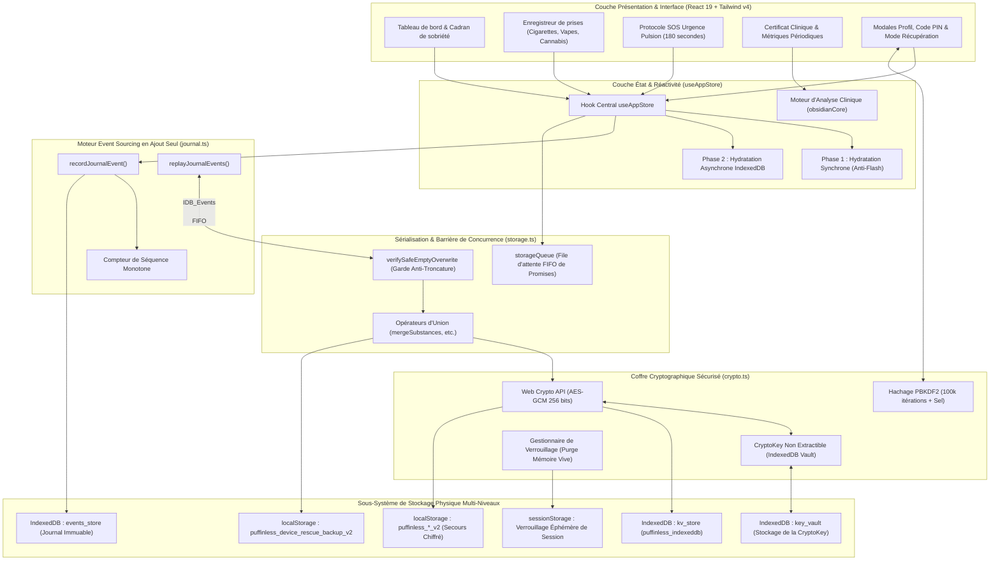

# PuffinLess — Manuel d'Architecture Système & Spécifications des Caractéristiques

**Version :** 2.0 (Édition Durcie : Journal d'Événements & Sécurité Cryptographique)  
**Classification :** Spécification d'Architecture Système Fondamentale  
**Paradigme Architectural :** 100% Embarqué (On-Device), Hors-Ligne (Offline-First), Zéro Télémétrie, Event Sourcing Multi-Niveaux Chiffré  
**Auteurs :** Équipe DeepMind Advanced Agentic Coding en Binôme de Programmation

---

## 1. Vue d'Ensemble & Philosophie Fondamentale

PuffinLess est une application web clinique autonome de sevrage tabagique, nicotinique (vapes/puffs), cannabique et d'habitudes personnalisées. Contrairement aux applications commerciales habituelles qui stockent les profils de santé sur des serveurs distants et utilisent des traqueurs d'analyse tiers, PuffinLess applique un principe absolu de **Confidentialité par Conception (Privacy-by-Design)** et de **Traitement 100% Local**.

### Caractéristiques Fondamentales
1. **Zéro Dépendance Réseau Externe (100% Hors-Ligne)** : Tous les calculs, l'indexation, le stockage, les chiffrements et les indicateurs cliniques sont exécutés exclusivement dans le navigateur de l'utilisateur. Aucune requête ne quitte l'appareil.
2. **Journal d'Événements Immuable en Ajout Seul (Append-Only Event Sourcing)** : Chaque action utilisateur est enregistrée sous forme d'événement discret et monotone dans un journal IndexedDB dédié (`events_store`), garantissant la rejouabilité totale, la résilience aux pannes et l'absence d'écrasement concurrent.
3. **Persistance Multi-Niveaux en Défense Approfondie** : Les données sont protégées simultanément sur quatre niveaux logiques et physiques : magasin Clé-Valeur IndexedDB, Journal d'Événements IndexedDB, LocalStorage v2 chiffré, et Snapshot de Sauvetage Local non modifiable.
4. **Chiffrement Authentifié AES-GCM (Web Crypto API)** : Chiffrement militaire matériel utilisant des clés non extractibles de 256 bits (`crypto.subtle`), un vecteur d'initialisation (IV) unique de 96 bits par opération et un hachage de sécurité PBKDF2 (100 000 itérations).
5. **Protection Anti-Troncature Stricte & Gestion Réelle des Erreurs** : L'enregistrement d'un tableau vide est bloqué si des données ou des erreurs de déchiffrement existent. Les corruptions et erreurs disque lèvent des exceptions explicites (`DecryptionError`, `Error`) et ne sont jamais confondues avec des données absentes.
6. **Rapports de Récupération Honnêtes et Détaillés** : Le moteur de récupération compare l'état antérieur et les nouvelles découvertes, indique si les données étaient déjà intactes, détaille les sources analysées et valide l'authenticité temporelle des dates.
7. **Distribution Monofichier Autonome** : Compilation en un unique fichier `.html` obfusqué et autonome (`dist/standalone.html`) intégrant polices et styles WOFF2 locaux, exécutable sans installation.

---

## 2. Diagramme Global de l'Architecture Système



---

## 3. Décomposition Détaillée des Caractéristiques par Module

### 3.1. Moteur Cryptographique (`src/utils/crypto.ts`)
Le moteur cryptographique assure la confidentialité, l'authenticité et la non-extractabilité des données utilisateur.

| Caractéristique | Spécification Technique | Règle d'Implémentation |
|---|---|---|
| **Algorithme de Chiffrement** | AES-GCM (Galois/Counter Mode) | Clé symétrique 256 bits, tag d'intégrité 128 bits |
| **Extractibilité de Clé** | `extractable: false` | Clé non lisible par JavaScript, isolée dans le navigateur |
| **Persistance de Clé** | IndexedDB `puffinless_key_vault` | Objet natif `CryptoKey` ; aucune clé brute en localStorage |
| **Vecteur d'Initialisation (IV)** | Dynamique 96 bits (12 octets) | `crypto.getRandomValues(new Uint8Array(12))` par opération |
| **Enveloppe du Payload** | `aes-gcm:<ivHex>:<ciphertextBase64>` | Format standardisé avec IV explicite |
| **États de Déchiffrement** | `readWithStatus` / `decryptWithStatus` | Distingue `'absent'`, `'success'`, `'decryption_error'` |
| **Purge Mémoire Vive** | `lockCryptographicVault()` | Efface `cachedCryptoKey` et `inMemoryKeyStore` lors du verrouillage |
| **Rétrocompatibilité** | Format legacy `aes256:` (CryptoJS) | Migration automatique vers AES-GCM dès la première sauvegarde |
| **Cryptoshredding** | Destruction irrévocable des clés | `purgeVaultKeys()` rend les données résiduelles indéchiffrables |

---

### 3.2. Journal d'Événements Immuable (`src/utils/journal.ts` & `src/utils/indexedDb.ts`)
PuffinLess adopte le modèle d'Event Sourcing pour prévenir les collisions et pertes d'historique lors d'écritures concurrentes.

```
+-----------------------------------------------------------------------------------------+
|                                    events_store                                         |
+-----+-----------------------+--------------------------+---------------------+----------+
| seq | type                  | timestamp                | payload             | entityId |
+-----+-----------------------+--------------------------+---------------------+----------+
| 1   | PROFILE_UPDATED       | 2026-02-10T08:00:00.000Z | { quitDate: ... }   | user     |
| 2   | SUBSTANCE_LOGGED      | 2026-02-10T09:30:00.000Z | { id: 'sub-1', ...} | sub-1    |
| 3   | CRAVING_LOGGED        | 2026-02-10T11:15:00.000Z | { id: 'crav-1', ...}| crav-1   |
| 4   | SUBSTANCE_REMOVED     | 2026-02-10T12:00:00.000Z | { logId: 'sub-1' }  | sub-1    |
| 5   | SAVINGS_GOAL_ADDED    | 2026-02-10T14:00:00.000Z | { id: 'goal-1', ...}| goal-1   |
+-----+-----------------------+--------------------------+---------------------+----------+
                                          |
                                          v
                                replayJournalEvents()
                                          |
                                          v
        +------------------------------------------------------------------+
        | Projections Reconstruites :                                      |
        | - substanceLogs : [] (Compensé par SUBSTANCE_REMOVED)            |
        | - cravings : [crav-1]                                            |
        | - goals : [goal-1]                                               |
        | - profilePatch : { quitDate: ... }                               |
        +------------------------------------------------------------------+
```

#### Catalogue des Événements
- `SUBSTANCE_LOGGED` : Enregistrement d'une consommation (cigarette, bouffée, cannabis).
- `SUBSTANCE_REMOVED` : Décrémentation compensatoire sans suppression destructrice de l'historique.
- `CRAVING_LOGGED` : Pulsion surmontée ou cédée avec intensité et facteur déclencheur.
- `STREAK_RECORDED` : Séries de jours sobres, ruptures et reprises.
- `PURCHASE_EXPENSE_LOGGED` & `PURCHASE_EXPENSE_DELETED` : Suivi des dépenses financières.
- `SLEEP_ENERGY_LOGGED` : Score de sommeil et niveau d'énergie au réveil.
- `SAVINGS_GOAL_ADDED`, `SAVINGS_GOAL_TOGGLED`, `SAVINGS_GOAL_DELETED` : Objectifs d'épargne.
- `PROFILE_UPDATED` : Modification des paramètres, déclencheurs ou date d'arrêt.

---

### 3.3. Concurrence, Sérialisation & Anti-Troncature (`src/utils/storage.ts`)

#### 1. File d'Attente FIFO (`storageQueue`)
Toutes les écritures passent par `storageQueue.enqueue()`. Cette file sérialise les promesses en ordre FIFO strict, éliminant les courses critiques et les écrasements asynchrones.

#### 2. Union & Fusion par Défaut
Lors de l'enregistrement de collections, le moteur effectue une union dédupliquée avec les données présentes sur le disque.
- **Résistance aux Rafales** : 20 ajouts déclenchés simultanément dans la même milliseconde sont tous préservés sans exception.
- **Écrasement Explicite** : Les suppressions volontaires spécifient `{ overwrite: true }`.

#### 3. Garde Anti-Troncature Étanche (`verifySafeEmptyOverwrite`)
L'enregistrement d'un tableau vide (`[]`) est formellement bloqué sauf si :
- L'utilisateur a demandé une réinitialisation explicite (`{ allowEmptyReset: true }`), **ET**
- Le stockage principal est certifié vierge ou absent, **ET**
- L'ancien stockage est certifié vierge ou absent, **ET**
- Le snapshot de secours ne contient aucun enregistrement.

> [!CAUTION]
> En cas d'erreur de déchiffrement (`decryption_error`) ou de panne d'accès au disque, `verifySafeEmptyOverwrite` lève immédiatement une exception `DecryptionError` ou `Error`. **Une défaillance de lecture n'est jamais interprétée comme une preuve d'absence de données.**

---

### 3.4. Moteur de Récupération Approfondie (`src/utils/recovery.ts`)

PuffinLess intègre un moteur de sauvetage capable de reconstruire l'intégralité du profil même après effacement partiel du cache.

#### Processus de Récupération
1. **Établissement du Référentiel Initial** : Capture des identifiants déjà présents en mémoire vive et sur disque avant le scan.
2. **Balayage Multi-Sources** :
   - Source 1 : Snapshot de Sauvetage Local (`puffinless_device_rescue_backup_v2`).
   - Source 2 : Magasin Clé-Valeur IndexedDB (`puffinless_indexeddb` / `kv_store`).
   - Source 3 : Journal d'Événements IndexedDB (`events_store`), rejoué via `replayJournalEvents`.
   - Source 4 : Clés Modernes LocalStorage (`puffinless_*_v2`).
   - Source 5 : Clés Historiques LocalStorage en AES-CBC (`puffinless_profile`, etc.).
3. **Contrôle Strict des Dates (`isValidDateField`)** :
   - Écarte les chaînes aléatoires, les valeurs non datées ou les dates hors limites.
   - Ne valide que les dates ISO-8601 réalistes situées entre `2000-01-01` et `maintenant + 24h`.
4. **Restitution Transparente et Non Surestimée** :
   - `hasNewlyRecoveredData` : Vrai **uniquement** si de nouveaux éléments manquants ont été restaurés.
   - `newlyRecovered` : Compte exact des séries, victoires, consommations, dépenses et objectifs réintégrés.
   - `integrity` : Affiche le volume analysé, validé et rejeté pour corruption.
   - Si les données étaient déjà intactes, l'interface indique : *"Toutes vos données sont déjà saines et synchronisées (0 élément manquant)."*

---

### 3.5. Sécurité d'Accès & Temporisation Anti-Force Brute (`src/utils/security.ts`)

| Paramètre | Valeur / Mécanisme | Rôle de Protection |
|---|---|---|
| **Hachage du Code PIN** | PBKDF2-HMAC-SHA256 | Résistance maximale aux attaques par dictionnaire hors ligne |
| **Itérations** | 100 000 itérations | Ralentissement cryptographique contre le cracking GPU/ASIC |
| **Sel Aléatoire** | 16 octets cryptographiques | Élimine les tables arc-en-ciel (rainbow tables) |
| **Temporisation Exponentielle** | `1s -> 2s -> 4s -> 8s -> ... -> 300s` | Rend impossible toute recherche exhaustive locale |
| **Frontière de Session** | Jeton `sessionStorage` | Distingue un rechargement d'onglet d'un redémarrage à froid du navigateur |

---

### 3.6. Métriques Cliniques Périodiques (`src/utils/clinicalMetrics.ts`)

Pour garantir la sincérité des graphiques et des bilans de santé :
- **Isolation Temporelle Stricte** : Les filtres Jour (24h), Semaine (7j), Mois (30j) et Global n'évaluent que les timestamps situés dans la fenêtre `[maintenant - période, maintenant]`.
- **Règle Zéro-Fuite** : Si aucune pulsion n'a eu lieu sur les dernières 24h, le bilan affiche strictement `0 pulsion` (100% de maîtrise), sans jamais basculer silencieusement sur l'historique global.
- **Rigueur Budgétaire** : Les économies représentent l'allocation théorique de la période moins les dépenses réelles saisies sur cette même fenêtre.

---

## 4. Pipeline de Production, Durcissement & Obfuscation

L'application est compilée sous la forme d'un fichier exécutable autonome et résistant au rétro-ingénierie :

```
src/ (TypeScript, React 19, CSS)
  │
  ├──> npx tsc -b                    (Vérification de types stricte, 0 erreur tolérée)
  ├──> vite build                    (Minification, découpage et compilation des modules)
  ├──> scripts/make-standalone.js    (Intégration du CSS, JS, SVG et polices WOFF2 en 1 seul HTML)
  └──> javascript-obfuscator         (Aplatissement de flux de contrôle, tables base64, mangling hexadécimal)
        │
        └──> dist/standalone.html    (Fichier monofichier autonome de ~2.7 Mo prêt au déploiement)
              │
              └──> Synchronisé vers : C:\Users\tiegb\Desktop\final version 1\PuffinLess_App.html
```

---

## 5. Banc de Vérification Automatisé (47 Tests Répartis sur 8 Piliers)

La suite de tests dans [`tests/engineering-verification.test.js`](file:///c:/Users/tiegb/Documents/WEB%20WORK/PuffinLess/tests/engineering-verification.test.js) s'exécute directement sur les modules de production réels sans aucun mock artificiel de la cryptographie ou de la persistance :

1. **Pilier 1 : Chiffrement AES-GCM via CryptoKey Non Extractible & Coffre IndexedDB** (6 tests)
2. **Pilier 2 : Hachage PBKDF2 (100k itérations) & Cryptoshredding Intégral** (2 tests)
3. **Pilier 3 : Métriques Périodiques Strictes & Fonctions de Production** (4 tests)
4. **Pilier 4 : Sécurité de Session, Verrouillage PBKDF2 & Redémarrage à Froid** (4 tests)
5. **Pilier 5 : Persistance Réelle IndexedDB, Migration & Récupération Zéro-Perte** (10 tests)
6. **Pilier 6 : Cycle de Vie Réel du Navigateur & Détection des Corruptions** (4 tests)
7. **Pilier 7 : Sauvegardes Anti-Troncature, Journal d'Événements & Concurrence** (17 tests)

---

## 6. Structure de l'Arborescence du Code

```
PuffinLess/
├── docs/                                          # Spécifications, audits et revues de sécurité
│   ├── ENGINEERING_ARCHITECTURE.md                # Notes d'architecture initiales
│   ├── SYSTEM_STRUCTURE_AND_CHARACTERISTICS_EN.md  # Manuel d'Architecture Système (Anglais)
│   ├── STRUCTURE_SYSTEME_ET_CARACTERISTIQUES_FR.md# Manuel d'Architecture Système (Français)
│   └── PuffinLess_Persistent_Memory_Storage_Review_2026-11-08.pdf
├── src/
│   ├── components/                                # Couche d'Interface et Composants React
│   │   ├── ProfileModal.tsx                       # Profil, export JSON et récupération transparente
│   │   ├── SosModal.tsx                           # Exercices et compte à rebours 180s pour pulsions
│   │   ├── ClinicalCertificateModal.tsx          # Bilan médical et métriques périodiques
│   │   └── ...
│   ├── core/
│   │   └── obsidianCore.ts                        # Modèles addictologiques, scores et citations
│   ├── state/
│   │   └── useAppStore.ts                         # Store réactif central avec écriture au journal
│   ├── types/
│   │   └── index.ts                               # Types TypeScript et schémas d'événements
│   └── utils/
│       ├── crypto.ts                              # Chiffrement AES-GCM, coffre de clés, effacement
│       ├── indexedDb.ts                           # Pilote IndexedDB kv_store & events_store
│       ├── journal.ts                             # Journal immuable & moteur de rejeu des projections
│       ├── recovery.ts                            # Moteur de restauration multi-sources
│       ├── storage.ts                             # File FIFO, union de fusion, garde anti-vide
│       ├── security.ts                            # Hachage PBKDF2 et temporisation exponentielle
│       ├── clinicalMetrics.ts                     # Calculs statistiques bornés à la période
│       └── dates.ts                               # Formatage et validation rigoureuse des dates
├── tests/
│   └── engineering-verification.test.js           # 47 tests automatisés de conformité
└── scripts/
    └── make-standalone.js                         # Pipeline d'injection et d'obfuscation
```

---

## 7. Règle Opérationnelle pour les Mises à Jour & Audits Futurs

À partir de cette version, toutes les revues d'ingénierie, audits de sécurité, vérifications cryptographiques et mises à jour majeures du système doivent être systématiquement exportés et documentés directement dans le dossier `docs/` du dépôt PuffinLess. Cette démarche garantit une traçabilité totale, une maintenabilité pérenne et une transparence intégrale pour l'utilisateur et les développeurs.
