# PuffinLess — System Structure & Characteristics Manual

**Version:** 2.4 (Atomic IndexedDB Sequence Allocation, Staged Encrypted Rescue Snapshots & Edge/Chrome Multi-Tab CDP Suite)  
**Classification:** Core System Architecture Specification  
**Architecture Paradigm:** 100% On-Device, Offline-First, Zero-Telemetry, Truly Atomic Multi-Store Persistence & Cross-Tab Monotonic Event Sourcing  
**Author:** DeepMind Advanced Agentic Coding Pair Programming Team

---

## 1. Executive Overview & Core Philosophy

PuffinLess is an autonomous, clinical-grade substance-recovery and sobriety-tracking web application designed for cigarettes, nicotine vapes/puffs, cannabis, and custom habits. Unlike typical commercial health applications that rely on remote cloud databases, third-party analytics, and centralized servers, PuffinLess is built on an uncompromising **Local-First, Privacy-by-Design** foundation.

### Foundational Characteristics
1. **Zero External Network Dependencies (100% Offline)**: All computation, data persistence, cryptographic encryption, and statistical analytics execute locally on the user's host browser. Zero network requests leave the device.
2. **Encrypted Append-Only Event Sourcing**: User interactions are recorded as discrete, monotonic, immutable journal events in an IndexedDB event store (`events_store`), encrypted at rest with Web Crypto AES-GCM 256-bit. Guarantees replayability, crash resilience, sequence monotonicity, and confidential auditability.
3. **Truly Atomic Multi-Store Persistence (`idbPersistAtomic` & `persistAtomicBatch`)**: Projections (`kv_store`) and discrete journal events (`events_store`) are committed together within a single ACID multi-store IndexedDB transaction. Payloads are pre-encrypted before opening the transaction to prevent auto-commit timeouts. All write operations resolve strictly on `tx.oncomplete`. If either write fails, the entire transaction aborts atomically, guaranteeing that the UI, IndexedDB projection, and event journal never disagree.
4. **Atomic Cross-Tab Monotonic Sequence Allocation (`idbAllocateNextSequence`)**: Sequence numbers are allocated atomically at the database engine level using an ACID `readwrite` transaction spanning `[STORE_NAME, EVENTS_STORE_NAME]`. Replaces unreliable `localStorage` lease spinlocks with database-enforced atomicity. Supported by `BroadcastChannel('puffinless_journal_sync')`, storage sync events, Web Locks API (`navigator.locks.request`), and an in-memory fallback mutex. If sequence allocation cannot be guaranteed, the allocator fails safely with an explicit `SequenceAllocationError` rather than generating duplicate or uncoordinated sequences.
5. **Fail-Visibly Storage & Optimistic Rollback Policy**: All journal and vault operations fail visibly. Critical write failures are never silently swallowed; if persistence or encryption fails, optimistic state updates in the UI store automatically roll back, an explicit exception propagates immediately, and a visible alert banner is rendered in the UI with a dedicated dismissal trigger (`data-testid="persistence-error-banner"`).
6. **Explicit Database Availability & Error Differentiation**: Database availability is probed explicitly via `isIndexedDBAvailable()`. Custom error classes `IndexedDBUnavailableError` and `IndexedDBTransactionError` carry full error causes and context. Database connections dynamically open at the current schema version without hardcoded version locks, preventing `VersionError` crashes on cold restart.
7. **Hardware-Accelerated Web Crypto AES-GCM with Key Mutex**: Military-grade authenticated encryption using non-extractable 256-bit Web Crypto keys (`crypto.subtle`), unique 96-bit initialization vectors (IVs) per operation, and PBKDF2 (100,000 iterations) key/PIN protection. Cold-boot concurrent key derivation is protected by a singleton promise lock (`subtleCryptoKeyPromise`), preventing divergent keys under concurrent initialization. Key material is stored exclusively in a dedicated IndexedDB Key Vault (`puffinless_key_vault`) with strict zero raw key material in `localStorage`.
8. **Strict Anti-Truncation & Error Distinction**: Empty arrays are rejected whenever existing data or decryption failures exist. Corrupted records or disk I/O errors throw explicit exceptions (`DecryptionError`, `Error`) and are never misconstrued as missing data.
9. **Staged Rescue Snapshots & Archival Safety (`RESCUE_ARCHIVE_KEY`)**: Device snapshots are pre-encrypted in memory before touching storage; an interrupted encryption or migration leaves previous valid backups untouched. On successful update, prior backups are safely staged to `puffinless_device_rescue_backup_archive` before overwriting primary keys. Multi-tier recovery transparently evaluates modern AES-GCM (`aes-gcm:`) and legacy plaintext JSON (`{...}`) snapshots, reporting authentic restored records, scanned storage engines, and verified date boundaries.
10. **Proactive Export Awareness & High-Contrast Ergonomics**: Profile settings present a prominent local-first backup reminder banner, reinforcing zero cloud storage and one-click JSON exports. Quantitative views, including the Financial Center (`MoneyView.tsx`), employ crisp high-contrast white typography (`#FFFFFF`) guaranteeing 100% clinical legibility.
11. **Single-File Portable Distribution**: Compiles to an obfuscated, fully standalone single `.html` file (`dist/standalone.html`) with embedded WOFF2 fonts and assets, deployable on any desktop or mobile browser without installation.

---

## 2. Global System Architecture Diagram

```mermaid
flowchart TD
    subgraph UI_Layer ["Presentation & UI Layer (React 19 + Tailwind v4)"]
        UI_Dash["Dashboard & Daily Sobriety Dial"]
        UI_Log["Intake Logger (Cigarettes, Puffs, Cannabis)"]
        UI_Money["Financial Center & High-Contrast Metrics (MoneyView)"]
        UI_ErrorBanner["Sticky Persistence Error Banner (data-testid='persistence-error-banner')"]
        UI_SOS["SOS Emergency 180s Craving Breaker"]
        UI_Cert["Clinical Certificate & Period Metrics"]
        UI_Modals["Profile, Backup Reminder & Recovery Modal"]
    end

    subgraph State_Layer ["State Management & Reactive Store (useAppStore)"]
        AppStore["useAppStore Hook"]
        SyncHydrate["Boot Phase 1: Sync Hydration (Zero-Flash)"]
        AsyncHydrate["Boot Phase 2: Async IDB Hydration"]
        SeqCoord["Cross-Tab Sequence Coordinator (BroadcastChannel + Storage)"]
        RollbackMgr["Optimistic State Rollback Manager"]
        CalcEngine["Clinical Calculation Engine (obsidianCore)"]
    end

    subgraph Atomic_Persistence ["Truly Atomic Persistence Engine (storage.ts & indexedDb.ts)"]
        BatchQueue["storageQueue (Promise FIFO Pipeline)"]
        AtomicBatch["persistAtomicBatch()"]
        PreEncrypt["Pre-Encryption Phase (AES-GCM before Tx)"]
        IdbAtomic["idbPersistAtomic() (Single ACID Multi-Store Tx)"]
        IdbSeqAlloc["idbAllocateNextSequence() (ACID Sequence Counter)"]
    end

    subgraph Journal_Layer ["Append-Only Event Sourcing Engine (journal.ts)"]
        RecEvent["recordJournalEvent() (Fail-Visibly)"]
        ReplayEngine["replayJournalEvents() (Multi-Entity Undo)"]
        MonotonicSeq["getNextMonotonicSequence() (Web Locks + IDB Mutex)"]
        ReadStatus["getHistoricalJournalEventsWithStatus() ('empty'|'success'|'error')"]
    end

    subgraph Crypto_Layer ["Cryptographic Security Vault (crypto.ts)"]
        WebCrypto["Web Crypto API (AES-GCM 256-bit)"]
        KeyMutex["subtleCryptoKeyPromise (Singleton Concurrency Mutex)"]
        NonExtract["Non-Extractable CryptoKey Vault (puffinless_key_vault)"]
        PBKDF2["PBKDF2 PIN Hashing (100k iter + Salt)"]
        LockMgr["Vault Lock Manager (Volatile Cache Purge)"]
    end

    subgraph Physical_Storage ["Multi-Tier Physical Storage Subsystem"]
        IDB_KV["IndexedDB: kv_store (puffinless_indexeddb + __seq_counter__)"]
        IDB_Events["IndexedDB: events_store (AES-GCM Encrypted at Rest)"]
        IDB_Vault["IndexedDB: key_vault (CryptoKey Storage)"]
        Local_V2["localStorage: puffinless_*_v2 (Encrypted Mirror)"]
        Rescue_Snap["localStorage: puffinless_device_rescue_backup_v2"]
        Rescue_Archive["localStorage: puffinless_device_rescue_backup_archive"]
        Session_Store["sessionStorage: Ephemeral Session Lock State"]
    end

    UI_Dash --> AppStore
    UI_Log --> AppStore
    UI_Money --> AppStore
    UI_SOS --> AppStore
    UI_Cert --> CalcEngine
    UI_Modals --> AppStore
    AppStore --> UI_ErrorBanner

    AppStore --> SyncHydrate
    AppStore --> AsyncHydrate
    AppStore --> SeqCoord
    AppStore --> RollbackMgr

    AppStore --> AtomicBatch
    AtomicBatch --> BatchQueue
    BatchQueue --> PreEncrypt
    PreEncrypt --> WebCrypto
    PreEncrypt --> IdbAtomic
    IdbAtomic --> IDB_KV
    IdbAtomic --> IDB_Events

    SeqCoord --> MonotonicSeq
    MonotonicSeq --> IdbSeqAlloc
    IdbSeqAlloc --> IDB_KV
    IdbSeqAlloc --> IDB_Events
    RecEvent --> MonotonicSeq
    ReadStatus <-- IDB_Events
    WebCrypto --> KeyMutex
    KeyMutex --> IDB_Vault
    AtomicBatch --> Local_V2
    AtomicBatch --> Rescue_Snap
    Rescue_Snap -. Safe Staging Archive .-> Rescue_Archive
```



---

## 3. The Tri-Directional Agreement Architecture

The primary structural risk in offline event-sourced client applications is **state desynchronization**: the possibility that the UI, the IndexedDB projection (`kv_store`), and the immutable event journal (`events_store`) record conflicting histories due to partial transaction failures, cross-tab race conditions, or asynchronous interleaving.

PuffinLess v2.4 eliminates this risk through three interlocking architectural mechanisms:

### 1. Pre-Encrypted Atomic Transactions (`idbPersistAtomic`)
In standard IndexedDB usage, performing asynchronous crypto operations inside an active transaction causes the browser to commit the transaction prematurely (auto-commit). To prevent this:
1. All projections (`profile`, `substanceLogs`, `cravings`, `expenses`, `goals`, `streaks`, `sleepEnergy`) and discrete journal events are **fully encrypted upfront** in memory before requesting any database transaction.
2. An IndexedDB transaction is opened spanning **both** object stores:
   ```typescript
   const tx = db.transaction([STORE_NAME, EVENTS_STORE_NAME], 'readwrite');
   ```
3. All pre-encrypted projection keys are written to `kv_store`, and all pre-encrypted journal events are appended to `events_store` synchronously within the exact same transaction.
4. All storage write helpers (`idbSet`, `idbRemove`, `idbClear`, `idbPersistAtomic`) resolve strictly on `tx.oncomplete`. If any single write fails, or if a hardware fault occurs, the browser rolls back the entire transaction atomically. Neither the projection nor the journal will reflect partial changes.

### 2. Optimistic State Rollback in UI Actions
Every user-triggered mutation in `useAppStore` captures a snapshot of current state before applying optimistic updates:
```typescript
const previousLogs = substanceLogs;
const previousCravings = cravings;
try {
  // Optimistic update
  setSubstanceLogs(newLogs);
  setCravings(newCravings);
  // Atomic persistence
  await persistAtomicBatch({
    projections: [{ key: 'substance_logs', value: newLogs }, { key: 'cravings', value: newCravings }],
    events: [substanceEvent, slipCravingEvent]
  });
} catch (err) {
  // Immediate rollback on persistence failure
  setSubstanceLogs(previousLogs);
  setCravings(previousCravings);
  setPersistenceError(err instanceof Error ? err : new Error(String(err)));
  throw err;
}
```
This guarantees that if the disk write fails, the UI does not display data that was not safely recorded on disk.

### 3. ACID Cross-Tab Monotonic Journal Sequencing (`idbAllocateNextSequence`)
When multiple tabs of PuffinLess are open simultaneously:
- **Atomic Database-Level Counter**: The allocator `idbAllocateNextSequence(minSeq)` opens an exclusive `readwrite` transaction across `[STORE_NAME, EVENTS_STORE_NAME]`. It inspects `JOURNAL_SEQ_COUNTER_KEY`, the maximum event sequence cursor from `events_store`, and cross-tab storage sync markers, incrementing the counter atomically within the database engine.
- **Fail-Safe Invariant**: If sequence allocation cannot be guaranteed (e.g. database unreachability or transaction abort), it immediately throws an explicit `SequenceAllocationError`. It never falls back to uncoordinated random sequence generation or duplicate sequences.
- **Web Locks Coordination**: Execution is synchronized across tabs using `navigator.locks.request('puffinless_journal_seq_lock')`. If Web Locks are unavailable, an in-memory mutex enforces strict FIFO queuing directly to the atomic database allocator.
- **Storage & Broadcast Sync**: `BroadcastChannel('puffinless_journal_sync')` and storage events immediately inform passive tabs of the newly advanced sequence.

---

## 4. Multi-Tier Physical Storage & Cryptographic Hierarchy

```
┌─────────────────────────────────────────────────────────────────────────────┐
│                       APPLICATION STATE (useAppStore)                       │
└──────────────────────────────────────┬──────────────────────────────────────┘
                                       │
                      Persist Atomic Batch Pipeline
                                       │
         ┌─────────────────────────────┴─────────────────────────────┐
         ▼                                                           ▼
┌─────────────────────────────────┐                 ┌─────────────────────────────────┐
│     PRIMARY STORAGE ENGINE      │                 │    SECONDARY FALLBACK ENGINE    │
│  IndexedDB (puffinless_indexeddb)│                 │     localStorage (Encrypted)    │
├─────────────────────────────────┤                 ├─────────────────────────────────┤
│ Store 1: 'kv_store'             │                 │ 'puffinless_profile_v2'         │
│  - Encrypted Projections        │                 │ 'puffinless_substance_logs_v2'  │
│  - Instant random-access state  │                 │ 'puffinless_cravings_v2'        │
│  - Atomic Journal Seq Counter   │                 │ 'puffinless_expenses_v2'        │
│    (__puffinless_journal_seq__) │                 │ 'puffinless_goals_v2'           │
│                                 │                 │ 'puffinless_streaks_v2'         │
│ Store 2: 'events_store'         │                 │ 'puffinless_sleep_energy_v2'    │
│  - Monotonic discrete events    │                 │                                 │
│  - AES-GCM Encrypted at rest    │                 │                                 │
│  - Monotonic index 'by_seq'     │                 │                                 │
└─────────────────────────────────┘                 └────────────────┬────────────────┘
                                                                     │
                                                    ┌────────────────┴────────────────┐
                                                    ▼                                 ▼
                                      ┌───────────────────────────┐     ┌───────────────────────────┐
                                      │   DUAL RESCUE SNAPSHOTS   │     │   HARDWARE CRYPTO VAULT   │
                                      │ puffinless_device_rescue  │     │   puffinless_key_vault    │
                                      │ _backup_v2 (Current AES)  │     │   - Non-Extractable IDB   │
                                      │           &               │     │   - subtleCryptoKeyPromise│
                                      │ puffinless_device_rescue  │     │     Singleton Mutex       │
                                      │ _backup_archive (Prior)   │     └───────────────────────────┘
                                      └───────────────────────────┘
```

---

## 5. Verification & Test Architecture

The reliability of PuffinLess persistence is enforced through a dual verification pipeline:

### 1. Unit & In-Memory Engineering Verification (`npm run test:unit`)
**71 Comprehensive Tests Across 7 Pillars (100% Pass Rate):**
- **Pillar 1**: Non-extractable Web Crypto AES-GCM keys, unique 96-bit IVs per write, clean error distinction.
- **Pillar 2**: PBKDF2 PIN hashing (100,000 iterations), cryptographic key erasure on reset.
- **Pillar 3**: Period-scoped clinical statistics calculation and boundary validation.
- **Pillar 4**: Cold restart vs standby session lock distinctions, transparent fallback recovery.
- **Pillar 5**: Real IndexedDB lifecycle, legacy AES-CBC migration, zero raw keys in localStorage.
- **Pillar 6**: Complete volatile memory wipe cold restart, corrupted record isolation.
- **Pillar 7**: Zero data loss safeguards, `idbPersistAtomic` ACID rollback, transaction completion resolution (`tx.oncomplete`), AES-GCM encrypted rescue snapshot staging and archival preservation, atomic `idbAllocateNextSequence` concurrent multi-tab allocation with zero collisions, fail-safe `SequenceAllocationError` enforcement, and transparent recovery from both legacy plaintext (`{...}`) and modern encrypted (`aes-gcm:`) backups.

### 2. Genuine Browser Verification Suite (`npm run test:browser`)
Executed against **Microsoft Edge (`msedge.exe`)** and **Google Chrome (`google-chrome`)** via the Chrome DevTools Protocol (CDP) on the compiled, obfuscated `dist/standalone.html`:
1. **Test 1: Real Application Store Actions (`window.__PUFFINLESS_STORE__`)**: Exercises production store actions (`completeOnboarding`, `logSubstance`, `resistCraving`, `addGoal`). Asserts rehydration, state propagation, and zero persistence error banners.
2. **Test 2: Genuine OS Cold Restart Across Processes**: Spawns a dedicated browser process, performs writes, forcibly terminates the OS process (wiping all RAM), and launches a second, distinct browser process against the same profile directory. Asserts complete state rehydration without `VersionError` or onboarding loops.
3. **Test 3: Tri-Directional Agreement Verification**: Reads the live UI store, queries `kv_store`, and traverses raw `events_store` via IndexedDB cursors. Verifies that `uiCount == projectionCount == journalEventsCount` with 100% agreement and strictly monotonic sequences.
4. **Test 4: Real Application Backup Import**: Invokes `actions.importUserData` with real backup JSON. Verifies non-destructive union-merging of existing and imported entities, profile updating, and error-free rendering.
5. **Test 5: Storage Failure, Atomic Rollback & Error Banner Verification**: Injects a transaction-level storage fault. Asserts that user actions fail visibly with thrown exceptions, optimistic in-memory changes roll back completely, the sticky error banner renders in the DOM (`[data-testid="persistence-error-banner"]`), and the banner dismisses cleanly upon user action.
6. **Test 6: Real Application Disaster Recovery across Storage Sabotage & Cold Restart**: Sabotages primary `kv_store` by clearing all projections in real IndexedDB, executes `store.actions.recoverLocalData()`, verifies report success and restoration of `RestoredHero` with all substance logs and goals, forcibly terminates the Edge browser process (purging volatile RAM), launches a fresh browser process (`session3`), and asserts 100% clean disk rehydration with zero error banners.
7. **Test 7: Real Simultaneous Multi-Tab Saves Across Concurrent Pages**: Opens two distinct browser pages simultaneously against the active browser session, performs rapid concurrent writes (`page1.logSubstance` and `page2.logSubstance`), and verifies that all journal events survive with 100% unique, collision-free, strictly monotonic sequence numbers.
8. **Test 8: Real Application Backup Export and Integrity Verification**: Invokes production backup export directly in the browser context, asserting authentic payload generation, presence of all entities, and total consistency with on-disk projections and event journal.

---

## 6. Directory Map & Code Structure

```
PuffinLess/
├── docs/                                           # Architecture, security audits & reviews
│   ├── ENGINEERING_ARCHITECTURE.md                 # Technical security notes
│   ├── SYSTEM_STRUCTURE_AND_CHARACTERISTICS_EN.md   # System Architecture Manual (English)
│   ├── STRUCTURE_SYSTEME_ET_CARACTERISTIQUES_FR.md # Manuel d'Architecture Système (Français)
│   └── PuffinLess_Persistent_Memory_Storage_Review_2026-11-08.pdf
├── src/
│   ├── components/                                 # UI Presentation layer
│   │   ├── MoneyView.tsx                           # High-contrast white typography Financial Center
│   │   ├── ProfileModal.tsx                        # Profile, backup reminder banner & recovery UI
│   │   ├── SosModal.tsx                            # 180-second craving protocol
│   │   ├── ClinicalCertificateModal.tsx           # Period-scoped medical summary
│   │   └── ...
│   ├── core/
│   │   └── obsidianCore.ts                         # Addiction metrics, clinical indicators, quotes
│   ├── state/
│   │   └── useAppStore.ts                          # Central store with sequence coordination & atomic actions
│   ├── types/
│   │   └── index.ts                                # TypeScript types, journal event schema
│   └── utils/
│       ├── crypto.ts                               # Web Crypto AES-GCM, key vault, singleton key mutex
│       ├── indexedDb.ts                            # idbPersistAtomic, idbAllocateNextSequence, dynamic version open
│       ├── journal.ts                              # Monotonic sequence coordination & Web Locks integration
│       ├── recovery.ts                             # Staged rescue snapshots, archive safety & recovery engine
│       ├── storage.ts                              # persistAtomicBatch, union merge, empty-array protection
│       ├── security.ts                             # PBKDF2 PIN hashing & exponential lockout
│       ├── clinicalMetrics.ts                      # Period-scoped calculations
│       └── dates.ts                                # Robust date formatting & parsing
├── tests/
│   ├── engineering-verification.test.js            # 71 comprehensive verification tests (100% green)
│   └── real-browser-verification.js                # 8 real Edge/Chrome CDP tests across OS processes (100% green)
└── scripts/
    └── make-standalone.js                          # Inliner & JavaScript obfuscation pipeline
```

---

## 7. Operational Policy for Future Audits & Updates

From this release forward, all engineering reviews, security audits, cryptographic assessments, and major structural changes must be systematically exported and versioned directly within the `docs/` directory of the PuffinLess repository. This guarantees long-term maintainability, full traceability, and historical auditability for users and developers alike.
