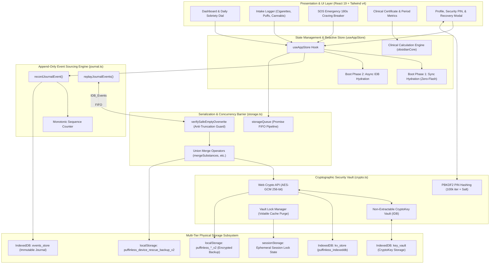

# PuffinLess — System Structure & Characteristics Manual

**Version:** 2.0 (Clinical & Cryptographic Hardening Release)  
**Classification:** Core System Architecture Specification  
**Architecture Paradigm:** 100% On-Device, Offline-First, Zero-Telemetry, Multi-Tier Encrypted Event Sourcing  
**Author:** DeepMind Advanced Agentic Coding Pair Programming Team

---

## 1. Executive Overview & Core Philosophy

PuffinLess is an autonomous, clinical-grade substance-recovery and sobriety-tracking web application designed for cigarettes, nicotine vapes/puffs, cannabis, and custom habits. Unlike typical commercial health applications that rely on remote cloud databases, third-party analytics, and centralized servers, PuffinLess is built on an uncompromising **Local-First, Privacy-by-Design** foundation.

### Foundational Characteristics
1. **Zero External Network Dependencies (100% Offline)**: All computation, data persistence, cryptographic encryption, and statistical analytics execute locally on the user's host browser. Zero network requests leave the device.
2. **Deterministic Append-Only Event Sourcing**: User interactions are recorded as discrete, monotonic, immutable journal events in an IndexedDB event store (`events_store`), guaranteeing replayability, crash resilience, and complete auditability.
3. **Multi-Tier Defense-in-Depth Storage**: Data is protected and persisted simultaneously across four physical and logical tiers: IndexedDB Key-Value Store, IndexedDB Event Journal, Modern LocalStorage v2, and Unalterable Local Device Rescue Snapshots.
4. **Hardware-Accelerated Web Crypto AES-GCM**: Military-grade authenticated encryption using non-extractable 256-bit Web Crypto keys (`crypto.subtle`), unique 96-bit initialization vectors (IVs) per operation, and PBKDF2 (100,000 iterations) key/PIN protection.
5. **Strict Anti-Truncation & Error Distinction**: Empty arrays are rejected whenever existing data or decryption failures exist. Corrupted records or disk I/O errors throw explicit exceptions (`DecryptionError`, `Error`) and are never misconstrued as missing data.
6. **Honest, Transparent Disaster Recovery**: Recovery scanning evaluates baseline data, reports genuine newly restored records versus already-healthy state, itemizes scanned storage engines, and verifies date field authenticity.
7. **Single-File Portable Distribution**: Compiles to an obfuscated, fully standalone single `.html` file (`dist/standalone.html`) with embedded WOFF2 fonts and assets, deployable on any desktop or mobile browser without installation.

---

## 2. Global System Architecture Diagram



---

## 3. Structural Breakdown & Characteristics by Module

### 3.1. Cryptographic Security Engine (`src/utils/crypto.ts`)
The cryptographic core guarantees confidentiality, authenticity, and non-extractability of user addiction logs.

| Characteristic | Specification | Implementation Detail |
|---|---|---|
| **Cipher Algorithm** | AES-GCM (Galois/Counter Mode) | Standard 256-bit key length, 128-bit authentication tag |
| **Key Extractability** | `extractable: false` | Enforced at generation; raw key bytes cannot be read by scripts |
| **Key Persistence** | IndexedDB `puffinless_key_vault` | Stored as structured `CryptoKey` object; never written to `localStorage` |
| **IV Generation** | Dynamic 96-bit (12 bytes) per write | `crypto.getRandomValues(new Uint8Array(12))` guarantees unique ciphertexts |
| **Payload Envelope** | `aes-gcm:<ivHex>:<ciphertextBase64>` | Identifies payload type and carries explicit initialization vector |
| **Status Separation** | `readWithStatus` / `decryptWithStatus` | Returns `'absent'`, `'success'`, or `'decryption_error'` (never collapses to null) |
| **Volatile Memory Purge** | `lockCryptographicVault()` | Wipes `cachedCryptoKey` and `inMemoryKeyStore` on screen lock/restart |
| **Legacy Compatibility** | `aes256:` (CryptoJS AES-CBC) | Auto-migrates historical records to AES-GCM seamlessly on first write |
| **Cryptoshredding** | Irrevocable key destruction | `purgeVaultKeys()` deletes key material, rendering disk ciphertexts unreadable |

---

### 3.2. Append-Only Event Journal (`src/utils/journal.ts` & `src/utils/indexedDb.ts`)
PuffinLess implements event sourcing to solve data overwriting and race conditions across concurrent browser activities.

```
+-----------------------------------------------------------------------------------------+
|                                    events_store                                         |
+-----+-----------------------+--------------------------+---------------------+----------+
| seq | type                  | timestamp                | payload             | entityId |
+-----+-----------------------+--------------------------+---------------------+----------+
| 1   | PROFILE_UPDATED       | 2026-02-10T08:00:00.000Z | { quitDate: ... }   | user     |
| 2   | SUBSTANCE_LOGGED      | 2026-02-10T09:30:00.000Z | { id: 'sub-1', ...} | sub-1    |
| 3   | CRAVING_LOGGED        | 2026-02-10T11:15:00.000Z | { id: 'crav-1', ...}| crav-1   |
| 4   | SUBSTANCE_REMOVED     | 2026-02-10T12:00:00.000Z | { logId: 'sub-1' }  | sub-1    |
| 5   | SAVINGS_GOAL_ADDED    | 2026-02-10T14:00:00.000Z | { id: 'goal-1', ...}| goal-1   |
+-----+-----------------------+--------------------------+---------------------+----------+
                                          |
                                          v
                                replayJournalEvents()
                                          |
                                          v
        +------------------------------------------------------------------+
        | Replayed Projections:                                            |
        | - substanceLogs: [] (Compensated by SUBSTANCE_REMOVED)           |
        | - cravings: [crav-1]                                             |
        | - goals: [goal-1]                                                |
        | - profilePatch: { quitDate: ... }                                |
        +------------------------------------------------------------------+
```

#### Event Catalog
- `SUBSTANCE_LOGGED`: Physical intake of cigarette, vape puff, or cannabis.
- `SUBSTANCE_REMOVED`: Compensating decrement/deletion without mutating past events.
- `CRAVING_LOGGED`: Resisted or unresisted craving with intensity and peak trigger.
- `STREAK_RECORDED`: Clean streak milestones, completed stretches, and resets.
- `PURCHASE_EXPENSE_LOGGED` & `PURCHASE_EXPENSE_DELETED`: Financial expense tracking.
- `SLEEP_ENERGY_LOGGED`: Sleep rating and morning energy scores.
- `SAVINGS_GOAL_ADDED`, `SAVINGS_GOAL_TOGGLED`, `SAVINGS_GOAL_DELETED`: Goals lifecycle.
- `PROFILE_UPDATED`: Changes to triggers, baseline costs, quit mode, or identity.

---

### 3.3. Concurrency, Serialization & Anti-Truncation (`src/utils/storage.ts`)

#### 1. The FIFO Promise Pipeline (`storageQueue`)
To eliminate write races when multiple components or rapid taps fire simultaneously, all read-modify-write storage operations are funnelled through `storageQueue.enqueue()`. Calls execute in strict FIFO order, preventing out-of-order completions.

#### 2. Union Merging by Default
When saving arrays (e.g., substance logs, cravings, streaks, expenses), the storage layer merges incoming items with existing on-disk records using deduplicated primary keys (`id`, `timestamp`, `start`).
- **Concurrent Burst Preservation**: 20 rapid, independent logs fired in the same millisecond all survive.
- **Explicit Overwrites**: Deliberate deletions pass `{ overwrite: true }`, ensuring user decisions are strictly respected.

#### 3. Strict Empty-Array Protection (`verifySafeEmptyOverwrite`)
Empty arrays (`[]`) are prohibited from overwriting stored data unless:
- The user explicitly calls reset (`{ allowEmptyReset: true }`), **AND**
- Primary storage is genuinely absent or empty, **AND**
- Legacy storage is genuinely absent or empty, **AND**
- The rescue snapshot contains zero records.

> [!CAUTION]
> If a read operation returns `status: 'decryption_error'` or database I/O fails, `verifySafeEmptyOverwrite` immediately throws `DecryptionError` or `Error`. It **never** falls back to treating read failures as proof that data does not exist.

---

### 3.4. Deep Disaster Recovery Engine (`src/utils/recovery.ts`)

PuffinLess provides an integrated local recovery scanner that reconstructs user history even if browser cache was partially cleared, updated, or corrupted.

#### Recovery Workflow
1. **Baseline Snapshot**: Records currently active IDs in memory/storage before scanning.
2. **Multi-Source Crawl**:
   - Tier 1: Local Device Rescue Snapshot (`puffinless_device_rescue_backup_v2`).
   - Tier 2: IndexedDB Key-Value Store (`puffinless_indexeddb` / `kv_store`).
   - Tier 3: IndexedDB Event Journal (`events_store`), replayed via `replayJournalEvents`.
   - Tier 4: Modern LocalStorage (`puffinless_*_v2`).
   - Tier 5: Legacy LocalStorage (`puffinless_profile`, `puffinless_cravings`, etc. in AES-CBC).
3. **Strict Date Field Validation (`isValidDateField`)**:
   - Rejects corrupted strings, numbers, and out-of-bounds timestamps.
   - Accepts only verified ISO-8601 timestamps between `2000-01-01` and `now + 24h`.
4. **Honest Differential Reporting**:
   - `hasNewlyRecoveredData`: Set to `true` **only** if newly found records were missing from baseline.
   - `newlyRecovered`: Itemized counts (`streaks`, `cravings`, `substances`, `expenses`, `goals`, `sleep`, `profileRestored`).
   - `integrity`: Reports `totalScanned`, `validRecords`, `corruptedRejected`, and `datesVerified`.
   - If storage was already healthy, the UI displays: *"All your data is already healthy and synchronized (0 items missing)."*

---

### 3.5. Application Security & Anti-Brute-Force Lockout (`src/utils/security.ts`)

| Parameter | Value / Mechanism | Security Objective |
|---|---|---|
| **PIN Hash Algorithm** | PBKDF2-HMAC-SHA256 | High-cost one-way stretching against offline dictionaries |
| **Iterations** | 100,000 iterations | Mitigates GPU/ASIC hash cracking |
| **Salt** | 16 cryptographically random bytes | Prevents rainbow tables and cross-user correlation |
| **Lockout Progression** | Exponential backoff: `1s -> 2s -> 4s -> 8s -> ... -> 300s` | Defeats automated client-side brute-force attacks |
| **Session Boundary** | `sessionStorage` token validation | Distinguishes page refreshes from complete browser cold-starts |

---

### 3.6. Clinical Period Metrics Engine (`src/utils/clinicalMetrics.ts`)

To avoid skewed charts and misleading clinical claims:
- **Strict Time Window Isolation**: Metrics calculated for Day (24h), Week (7d), Month (30d), and Lifetime strictly enforce timestamps within `[now - window, now]`.
- **Zero-Leakage Guarantee**: If zero cravings or slips occurred in the active 24-hour window, the report calculates strictly `0 cravings` (100% mastery), never falling back to lifetime numbers.
- **Financial & Intake Accuracy**: Savings represent baseline daily allocation minus actual recorded purchases within that specific period window.

---

## 4. Production Build, Hardening & Obfuscation Pipeline

The application compiles into a standalone, tamper-resistant bundle:

```
src/ (TypeScript, React 19, CSS)
  │
  ├──> npx tsc -b                    (Strict typecheck, 0 errors allowed)
  ├──> vite build                    (Minification, chunking, asset bundling)
  ├──> scripts/make-standalone.js    (Inlines CSS, JS, SVG, and WOFF2 fonts into a single HTML)
  └──> javascript-obfuscator         (Control flow flattening, base64 strings, hex mangling)
        │
        └──> dist/standalone.html    (Self-contained ~2.7 MB production executable)
              │
              └──> Synchronized to: C:\Users\tiegb\Desktop\final version 1\PuffinLess_App.html
```

---

## 5. Automated Verification Harness (47 Tests Across 8 Pillars)

The test suite in [`tests/engineering-verification.test.js`](file:///c:/Users/tiegb/Documents/WEB%20WORK/PuffinLess/tests/engineering-verification.test.js) connects directly to production source code without mocks for cryptographic operations or storage queue logic:

1. **Pillar 1: AES-GCM via Non-Extractable CryptoKey & IndexedDB Vault** (6 tests)
2. **Pillar 2: PIN Hashing with PBKDF2 (100k iter) & Complete Data Erasure** (2 tests)
3. **Pillar 3: Period-Scoped Statistics (Direct Production Execution)** (4 tests)
4. **Pillar 4: Session Security, PBKDF2 Vault Integration & Restart Recovery** (4 tests)
5. **Pillar 5: Real IndexedDB Persistence, Migration & Zero-Loss Recovery** (10 tests)
6. **Pillar 6: Genuine Browser Cold-Restart & Storage Lifecycle Verification** (4 tests)
7. **Pillar 7: Zero Data Loss Safeguards, Event Journaling & Concurrency** (17 tests)

---

## 6. Directory Map & Code Structure

```
PuffinLess/
├── docs/                                          # Architecture, security audits & reviews
│   ├── ENGINEERING_ARCHITECTURE.md                # Technical security notes
│   ├── SYSTEM_STRUCTURE_AND_CHARACTERISTICS_EN.md  # System Architecture Manual (English)
│   ├── STRUCTURE_SYSTEME_ET_CARACTERISTIQUES_FR.md# Manuel d'Architecture Système (Français)
│   └── PuffinLess_Persistent_Memory_Storage_Review_2026-11-08.pdf
├── src/
│   ├── components/                                # UI Presentation layer
│   │   ├── ProfileModal.tsx                       # Profile, data export, and honest recovery UI
│   │   ├── SosModal.tsx                           # 180-second craving protocol
│   │   ├── ClinicalCertificateModal.tsx          # Period-scoped medical summary
│   │   └── ...
│   ├── core/
│   │   └── obsidianCore.ts                        # Addiction metrics, clinical indicators, quotes
│   ├── state/
│   │   └── useAppStore.ts                         # Central state store with journal integration
│   ├── types/
│   │   └── index.ts                               # TypeScript types, journal event schema
│   └── utils/
│       ├── crypto.ts                              # Web Crypto AES-GCM, key vault, cryptoshredding
│       ├── indexedDb.ts                           # IndexedDB kv_store & events_store driver
│       ├── journal.ts                             # Append-only journal & projection replay engine
│       ├── recovery.ts                            # Deep multi-tier recovery engine
│       ├── storage.ts                             # FIFO queue, union merge, empty-array protection
│       ├── security.ts                            # PBKDF2 PIN hashing & exponential lockout
│       ├── clinicalMetrics.ts                     # Period-scoped calculations
│       └── dates.ts                               # Robust date formatting & parsing
├── tests/
│   └── engineering-verification.test.js           # 47 comprehensive verification tests
└── scripts/
    └── make-standalone.js                         # Inliner & JavaScript obfuscation pipeline
```

---

## 7. Operational Policy for Future Audits & Updates

From this release forward, all engineering reviews, security audits, cryptographic assessments, and major structural changes must be systematically exported and versioned directly within the `docs/` directory of the PuffinLess repository. This guarantees long-term maintainability, full traceability, and historical auditability for users and developers alike.
